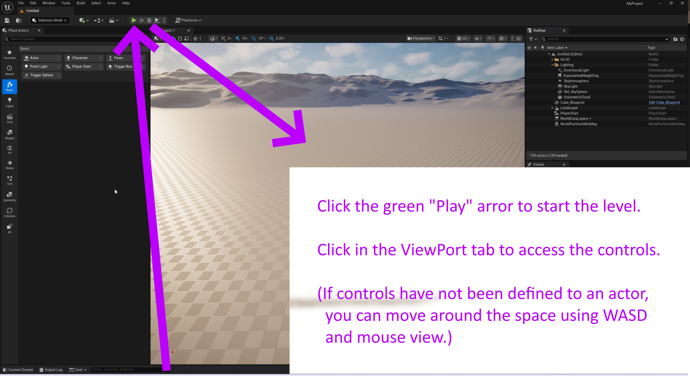

# Unreal: Playing a Level

> Legacy lesson, organized for self-study. Screenshots may show an older editor. See the Unreal 5.8 verification scope (legacy attachment omitted) before relying on version-specific steps.

The Unreal Editor provides a convenient green Play button above the Place Actors tab or more over the Viewport tab, depending on screen size.)

## Playing a Level

*Figure: Screenshot of Unreal Editor with "Play" button highlighted.*

If the Viewport has control (focus), you can move around the camera in the level.

In those genres and modes with pre-defined controls (i.e., First Person, Third Person, etc.), clicking into the Viewport will automatically give control over a defined actor in the level.

## Stopping Play

Pressing ESCAPE (ESC) key on a keyboard will automatically stop play and give control back to the Unreal Editor. (In more advanced projects, it will be possible to have the cursor leave an active game, but not by default in most modes and pre-defined genre projects.
