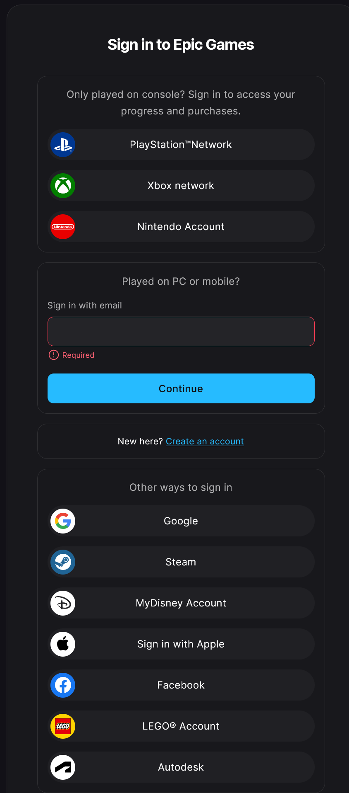
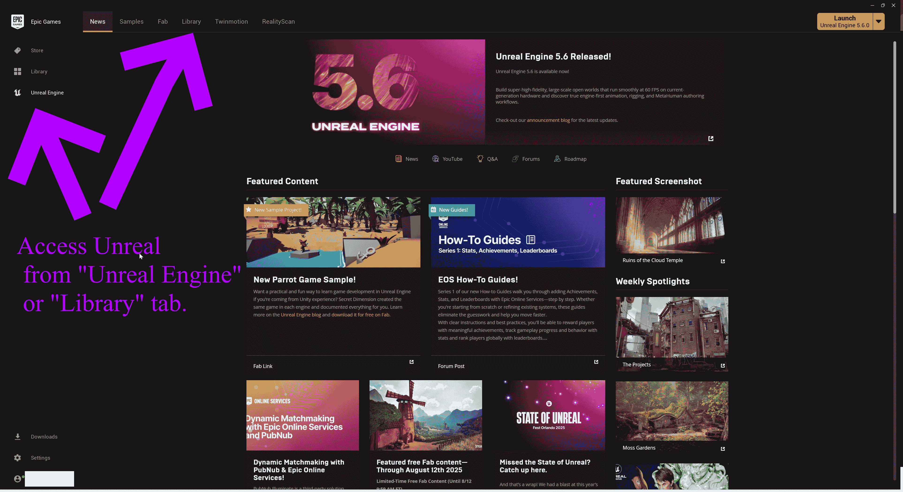
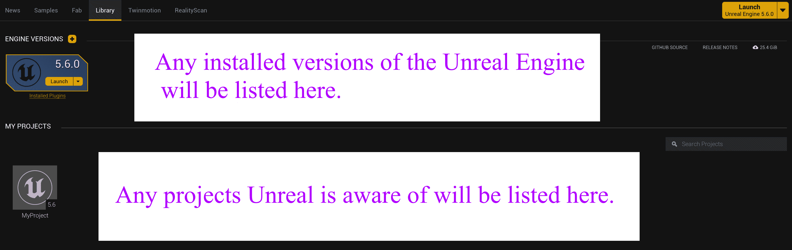
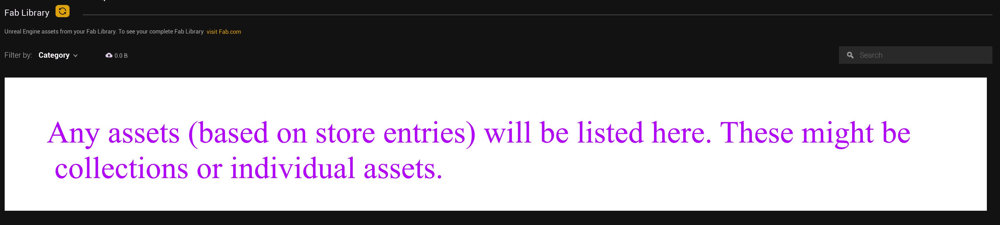
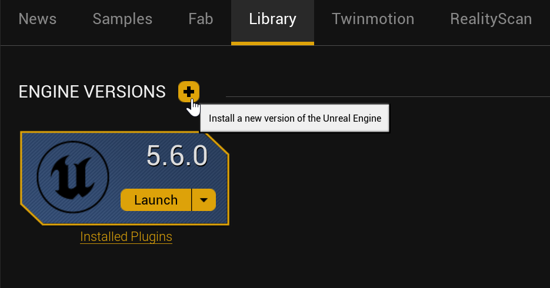
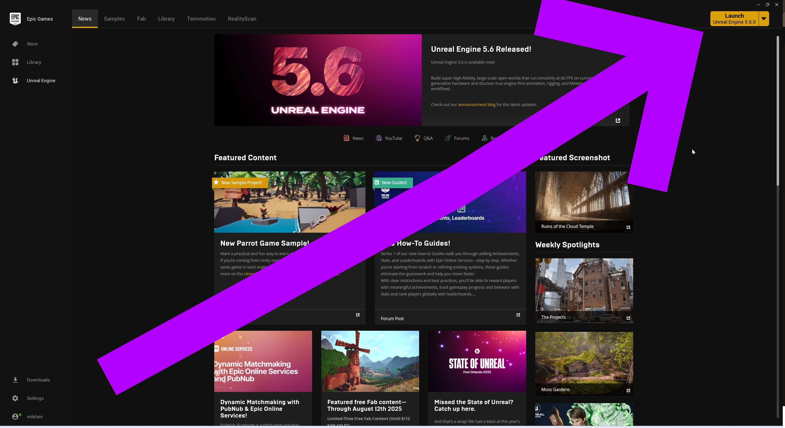

# Unreal: Understanding the Epic Games Launcher

> Legacy lesson, organized for self-study. Screenshots may show an older editor. See the Unreal 5.8 verification scope (legacy attachment omitted) before relying on version-specific steps.

The Unreal game engine is found inside another application, the [Epic Games Launcher](https://store.epicgames.com/en-US/download). This must be downloaded and installed to easily access the Unreal game engine itself.

To sign-up to use the Epic Games Launcher, you need an account. You can supply an email or use other services like the following:

*Figure: Screenshot of Available Accounts to log into Epic Games Launcher including Sony, Xbox, and Nintendo.*

After logging in, the Epic Games Launcher will assume the same user is returning when opening the app again in the future. The Epic Games Launcher is not used for a long period of time (generally weeks), it will automatically log out the user. This may also happen during any updates to the Epic Games Launcher between major version.

## Understanding the Epic Games Launcher

The Epic Game Launcher can be used to "launch" both the Unreal Engine and any games installed using it. To access the Unreal Engine after logging into the Launcher, click on "Unreal Engine" from the left sidebar or "Library" tab from the top selections.

*Figure: Screenshot showing "Unreal Engine" from left sidebar and "Library" tab.*

### (Unreal) Library

The Library tab shows three important sections. First, it will list any installations of the Unreal Engine itself and its version. Second, it will list any projects it is aware of and their names.

*Figure: Screenshot of Library tab in the Epic Games launcher.*

The third and final sections of the Library tab is any Fab.com assets you have purchases, including any free assets you may have activated on the store.

*Figure: Screenshot of Fab Library section from the Library tab of the Epic Games Launcher.*

## Installing Unreal Engine Per Version

The Unreal game engine can be installed based on the latest minor version of each major version. (As of the time of this writing, Unreal 5.6.0 is the latest version.)

Click on the "+" symbol and select Unreal 5.6.

*Figure: Screenshot of the Engine Version section of the Library tab.*

## Launching Unreal Engine

If at least one version of the Unreal Engine is installed, its own launcher can be accessed from the upper, right-hand corner. Once installed, the process of Epic Games Launcher to Unreal Engine is clicking on upper, right-hand corner.

*Figure: Screenshot showing the "Launch" option in the upper, right-hand corner of the Epic Games Launcher.*
