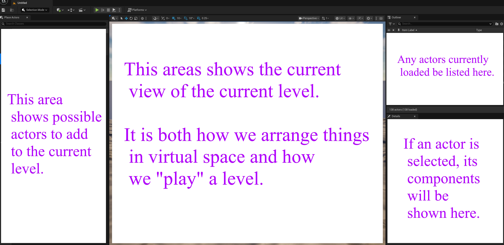

# Unreal: Understanding the Unreal Editor

> Legacy lesson, organized for self-study. Screenshots may show an older editor. See the Unreal 5.8 verification scope (legacy attachment omitted) before relying on version-specific steps.

When opened, the Unreal Editor has multiple areas dedicated to its core concepts arranged from left to right across the screen.

- Starting from the left, the first area is the Place Actors tab. This lists possible actors to add to the current level.
- In the middle of the screen is the Viewport tab current view of the current level. When arranging actors, we can select them in the level.
- On the top right is the Outliner tab. This *outlines* all of the currently loaded actors in the current level.
- Below the Outliner tab is the Details tab. When an actor is selected in the Outliner tab, its current components and their values will be shown.

*Figure: Screenshot of the Unreal Editor showing different areas of the screen and descriptions of their usage.*
