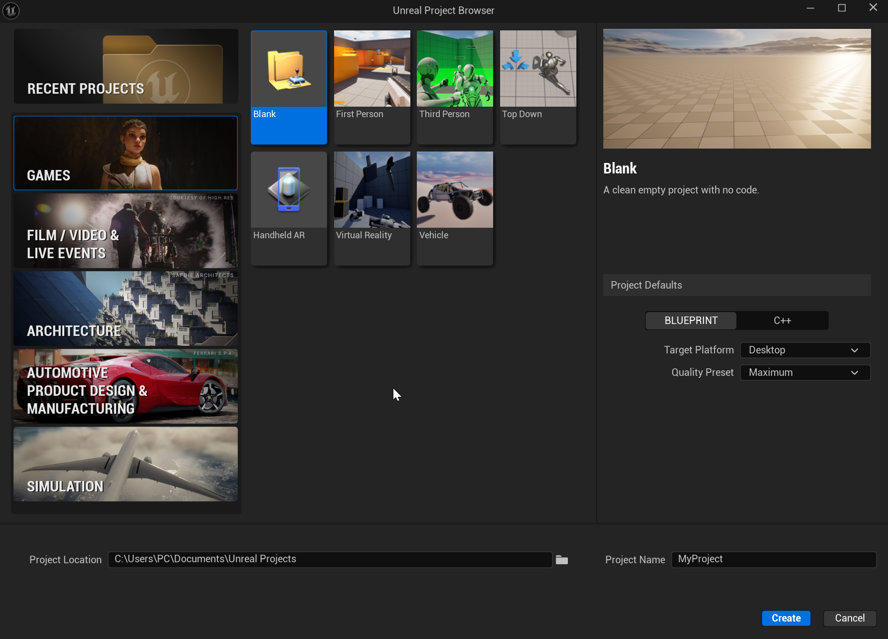
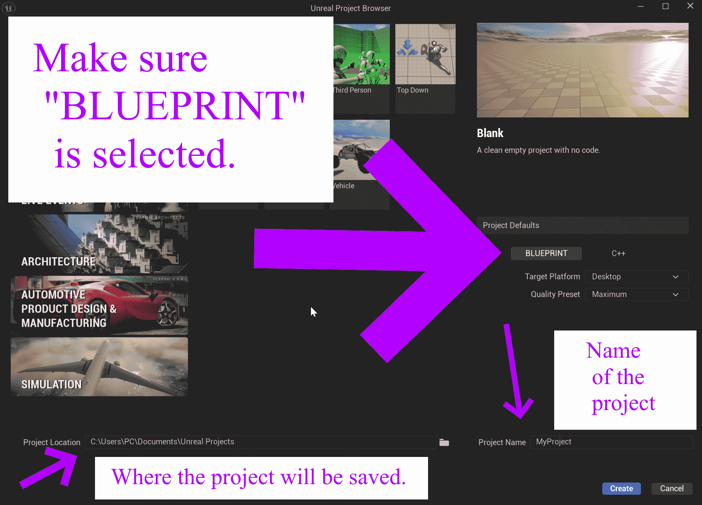

# Unreal: Understanding the Unreal Project Browser

> Legacy lesson, organized for self-study. Screenshots may show an older editor. See the Unreal 5.8 verification scope (legacy attachment omitted) before relying on version-specific steps.

When launched from inside the Epic Games Launcher, Unreal will open its Project Browser. This lists default the templates for types of common projects based on type and genre.

(If launching an existing project from the Epic Games Launcher, the Unreal Project Browser will be bypassed and the project opened directly.)

*Figure: Screenshot of Unreal Project Browser.*

## Breaking Down the Unreal Project Browser

*Figure. Screenshot of Unreal Project Browser showing the Project Location, Project Name, and Project Defaults.*

When creating a new project, select a type (from "Recent Projects", "Games", "Film / Video & Live Events", "Architecture", etc.) and then a genre (from "First Person", "Third Person", "Top Down", etc.).

In the bottom, left-hand corner will be where the project will be save and in the right-hand corner will be the name of the project.

**NOTE**: If saving the project to removable media (like a USB drive), be sure to select that location for creating the project. Once created, it can be run directly from this location.
