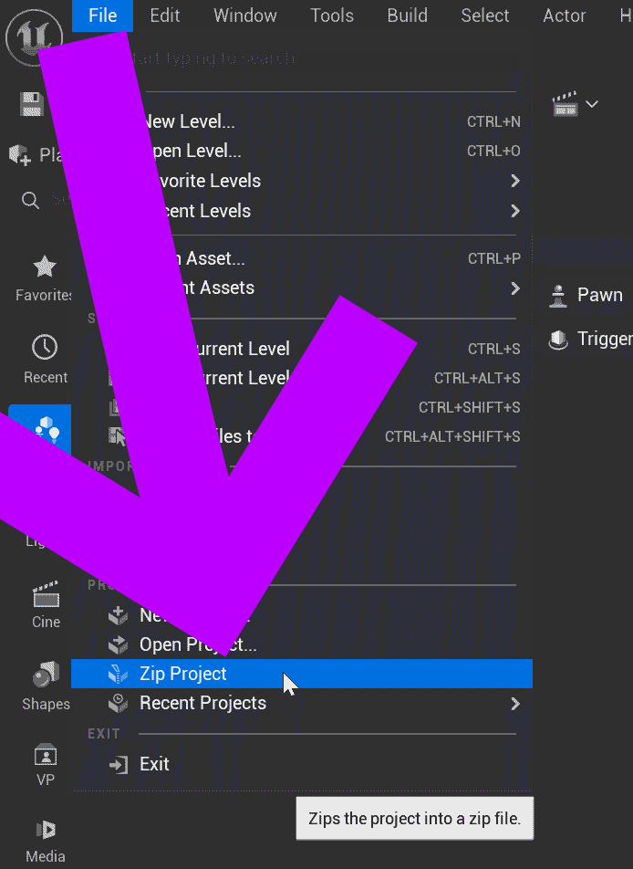
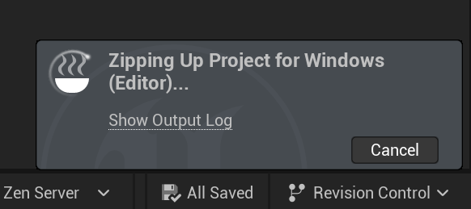

# Unreal: ZIP Project (For larger projects, this process can take multiple minutes.)

> Legacy lesson, organized for self-study. Screenshots may show an older editor. See the Unreal 5.8 verification scope (legacy attachment omitted) before relying on version-specific steps.

It is possible to "export" an entire project as a single ZIP file. This is a convenient way to send your project to another person as-is and have them open and work on it.

**WARNING: For larger projects, especially those with many models or larger files, the zipping process can take large amounts of time.**

## Creating a ZIP File from a Project

From within the Unreal Editor, a project can be saved to a ZIP file using the File -\> Zip Project option.

*Figure: Screenshot focused on the File -\> Zip Project option.*

From the windows, select where to save the file. If moving between computers, it is recommended to save to an external drive (like a USB drive) or cloud saving service (like Dropbox).

When running, the Unreal Editor will show a message as it packages the project into a ZIP file.

*Figure: Screenshot showing the "Zipping Up Project" message.*
