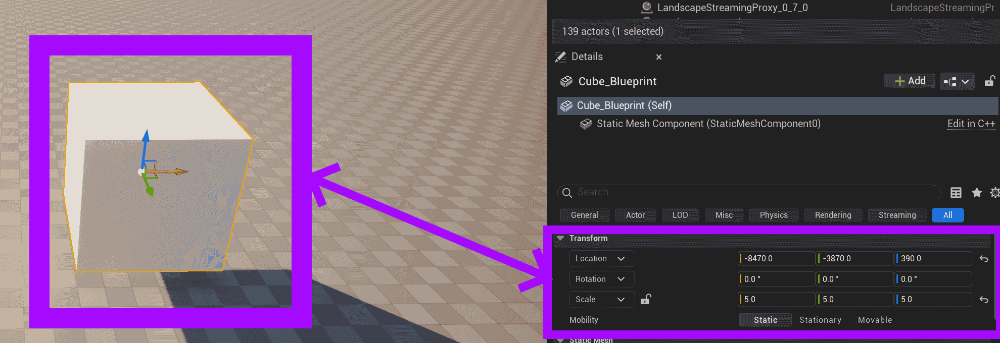

# Unreal: Arranging Actors using the Transform Tool

> Legacy lesson, organized for self-study. Screenshots may show an older editor. See the Unreal 5.8 verification scope (legacy attachment omitted) before relying on version-specific steps.

Every Actor shares a common component named *Transform*. This has three values:

- Location: Where the Actor is currently in a level.
- Rotation: If the Actor is currently turned.
- Scale: How large (relative to its original shape) the Actor currently is.

When an actor is selected in the Outliner tab, its values can be adjusted using a tool positioned in the center of the actor in the Viewport tab. This is known as the *Transform* tool.

*Figure: Screenshot of Transform tool for an actor and its connection to Transform component.*

When the cursor is placed over an axis of the Transform tool for an actor, the axis can be dragged to adjust the connected value. This can be useful to drag an actor into a position or rotate it without needing to adjust the value directly.

**NOTE:** Unreal uses colors to help guide developers. The colors of the Transform tool axis match the same colors of the values in the Transform component.
