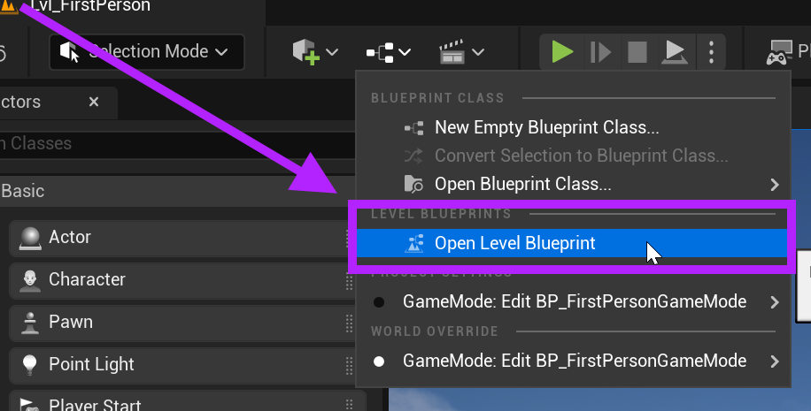

# Unreal: Blueprints: Levels: What is a level?

> Legacy lesson, organized for self-study. Screenshots may show an older editor. See the Unreal 5.8 verification scope (legacy attachment omitted) before relying on version-specific steps.

In Unreal, everything is a blueprint. This extends from actors to levels and even the game itself. Because of this approach, the level in which actors can be found can be accessed and programming added because it is a blueprint.

## *Why have a level blueprint?*

There might be situations where data need to be passed to a particular actor or multiple copies of some actor need to be created for some purpose when play begins or a level is loaded. Where should this programming occur? If it was part of any one actor, it would affect only that actor because of the is-a and has-a issue. An actor only "knows" what it is and what it has.

What if there a blueprint "above" all the actors collected within it? This is where the concept of a level blueprint is useful. It can act before the actors or pass them data without needing to add this same programming in any one actor.

## Accessing the Level Blueprint

In Unreal, the Level Blueprint can be accessed by clicking the list of blueprints and selecting the "Open Level Blueprint" option:

*Figure: Screenshot highlighting Open Level Blueprint.*

## Level Blueprint as "above" the actors it contains

We place actors in levels. This means the level "has" the actors. In other words, any actor currently in the level can be accessed in the Level Blueprint by using an object reference.
