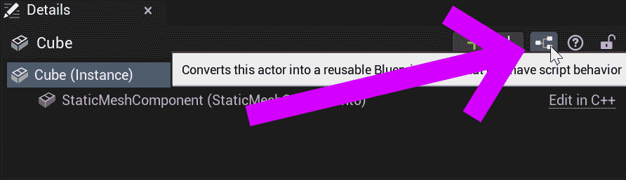
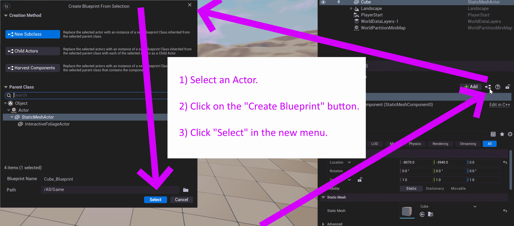
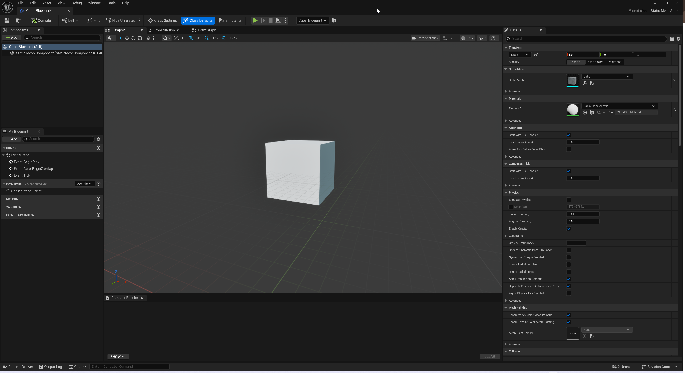
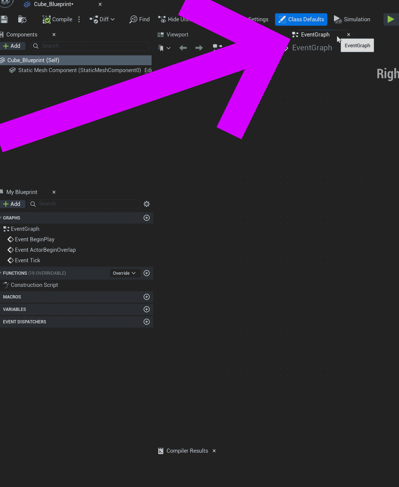

# Unreal: Creating a Blueprint based on an Actor

> Legacy lesson, organized for self-study. Screenshots may show an older editor. See the Unreal 5.8 verification scope (legacy attachment omitted) before relying on version-specific steps.

With an Actor selected in the Outliner tab, a Blueprint can be created by clicking on the button next to "Add" in the top row of the Details tab.

*Figure: Screenshot showing the "Convert to Blueprint" button in the Details tab in the Unreal Editor.*

When clicked, a new menu will open showing possible options.

*Figure: Screenshot of creating a Blueprint for an Actor in Unreal Editor.*

When an Actor has a Blueprint, it can be opened in the Blueprint Editor.

*Figure: Screenshot of Blueprint Editor for a Cube Actor.*

While there are many options, we almost always want the Event Graph tab.

*Figure: Screenshot of EventGraph in the Blueprint Editor.*

The Event Graph shows any *events* the Actor is tracking and what happens as a result.
