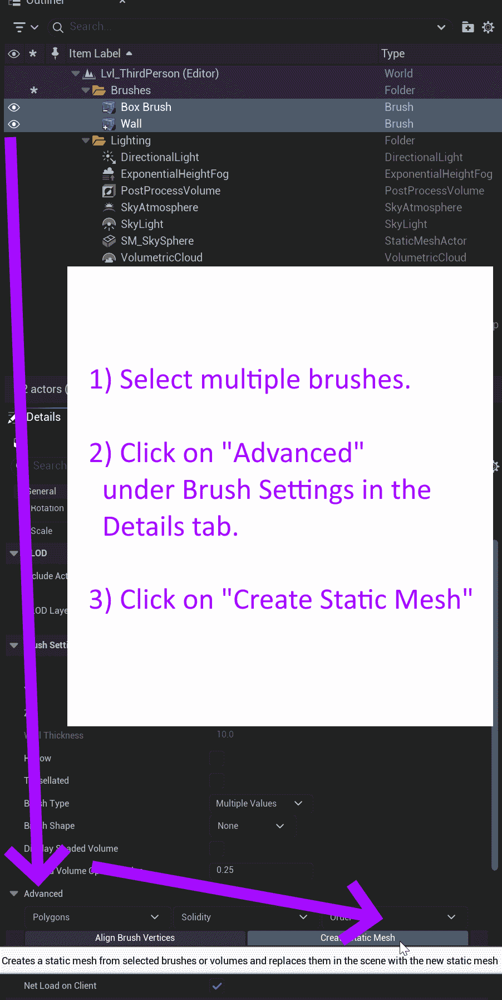
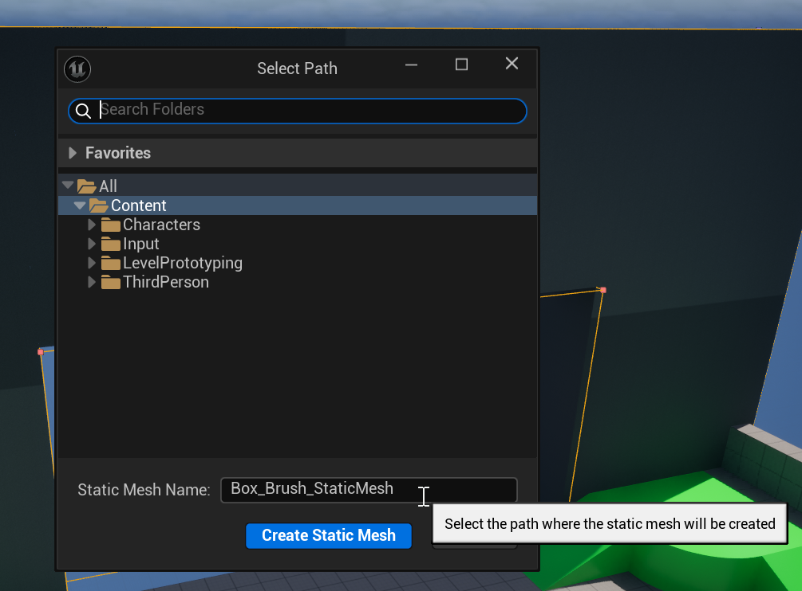
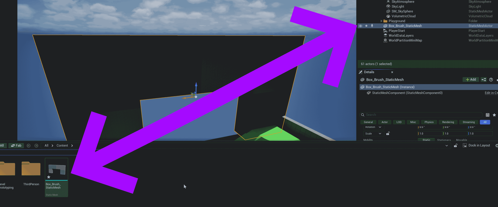

# Unreal: Geometry: Converting Multiple Brushes into a Single Static Mesh

> Legacy lesson, organized for self-study. Screenshots may show an older editor. See the Unreal 5.8 verification scope (legacy attachment omitted) before relying on version-specific steps.

Geometric actors are very useful because of the use of "additive" and "subtractive" types. However, we can sometimes create many brushes to create more abstract or creative shapes. While we can collect them into folders, we can also perform a different action: converting multiple brushes into a single static mesh.

## *Why would we want to convert brushes into static mesh?*

There one more thing important to the comparison between shapes and geometric actors. **A static mesh can easily be shared across levels.** We can define a more complex arrangement using multiple additive and subtractive actors and then re-use it as needed.

## Converting Multiple Brushes into a Single Static Mesh

First, we need to select multiple brushes in the Outliner.

*Figure: Screenshot of selecting multiple brushes in the Outliner tab in the Unreal Editor.*

Second, we can name the new static mesh and place it in a folder.

*Figure: Screenshot of Creating a Static Mesh in the Unreal Editor.*

The created static mesh will replace the previous brushes and add an entry in the Content Drawer (the option in the bottom, left-hand corner).

*Figure: Screenshot showing the connection between the created static mesh in the Outliner tab and Content Drawer.*
