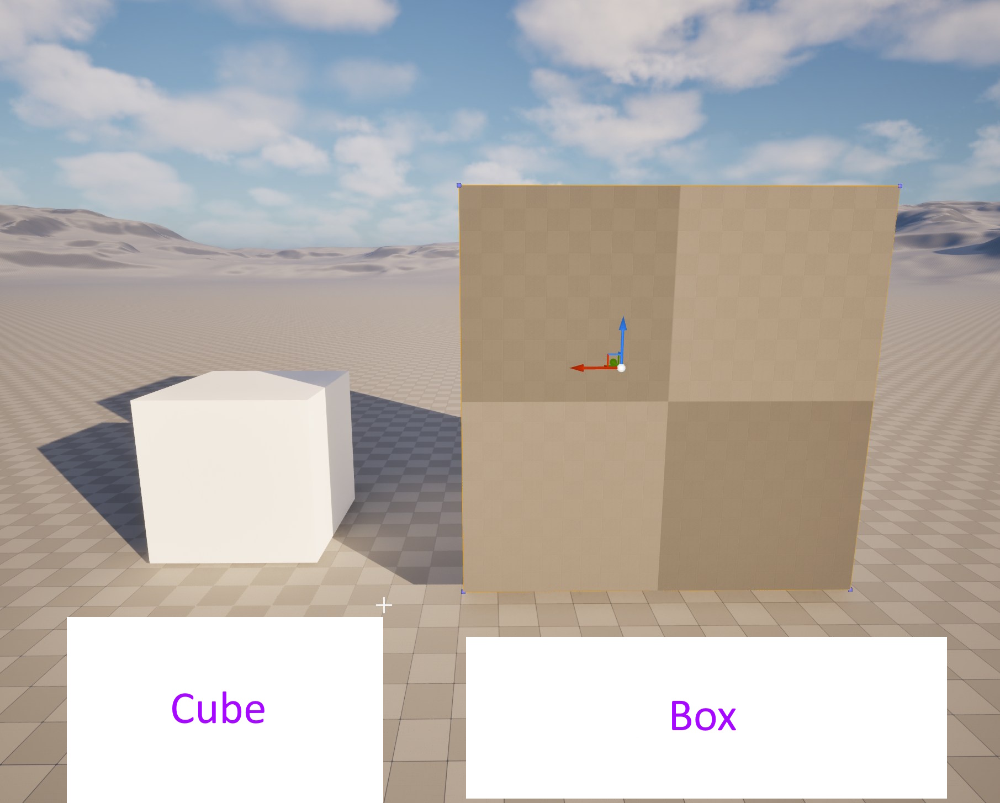
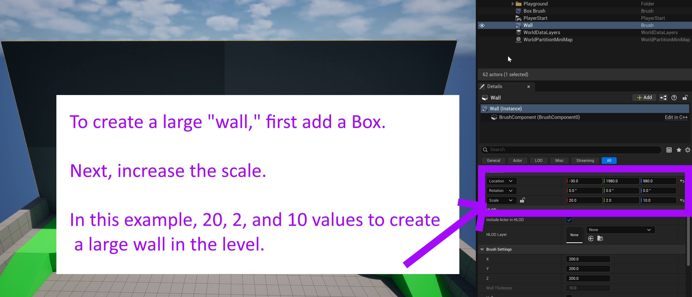
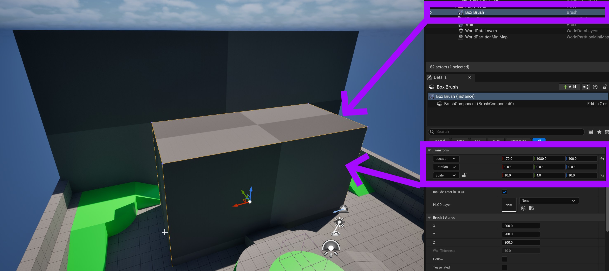
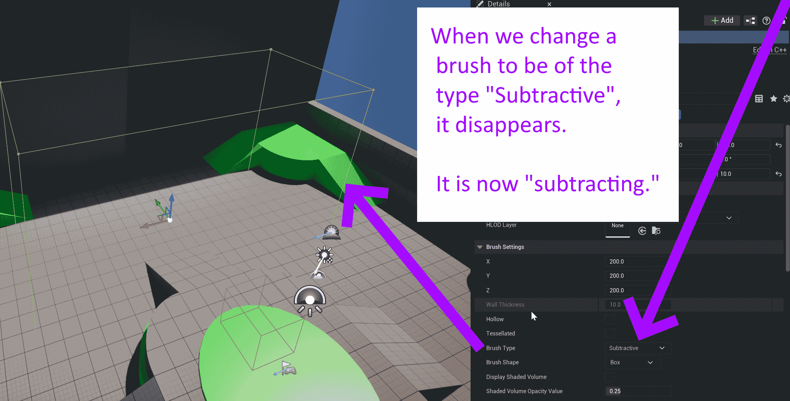
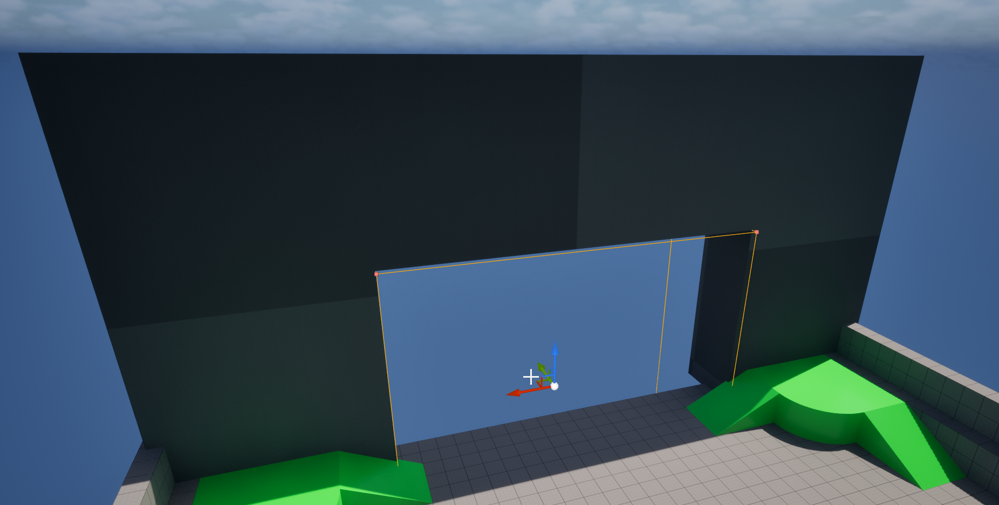

# Unreal: Geometry: Creating Holes with Subtractive Geometry

> Legacy lesson, organized for self-study. Screenshots may show an older editor. See the Unreal 5.8 verification scope (legacy attachment omitted) before relying on version-specific steps.

At first, geometry may not seem useful. After all, both shapes and geometry can take up space in a level.

*Figure: Screenshot demonstrating a Cube (shape) and Box (geometry) in Unreal Editor.*

While we can think of geometry as the "lightweight" version of a shape, one major advantage of using one (geometry) over a shape is in the ability to "subtract" from other, existing geometry. We can add one geometric shape, for example, a wall, and then "carve" out the shapes we want by adding another geometry using a different type of brush.

Let's see an example in action.

First, I will add a geometric Box and then scale up (changing the Transform -\> Scale values) to create a large wall-like structure.

*Figure: Screenshot showing the use of the Box geometric actor with increased Scale values.*

Let's now add a second Box and also scale it up. This time, however, not as big.

*Figure: Screenshot showing second Box in the Unreal Editor.*

To "carve out" the larger Box using the smaller one, we change two things.

First, we change the *Brush Type* of the second Box to be "Subtractive".

*Figure: Screenshot of a Box brush using "Subtractive" type.*

Second, we move the now "subtracting" Box into the previous one, "carving out" the space taken up by the new one.

*Figure: Screenshot of combined Boxes with a second using the "Subtractive" brush type.*
