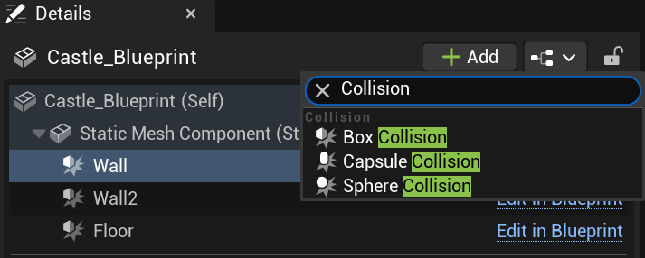
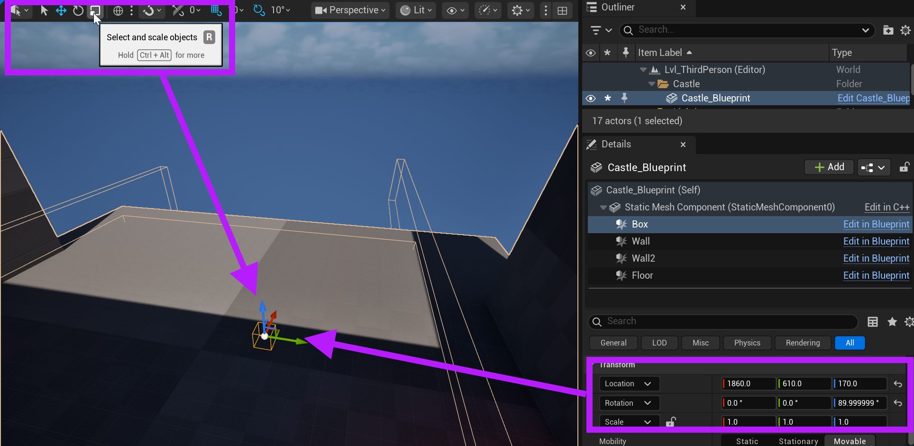
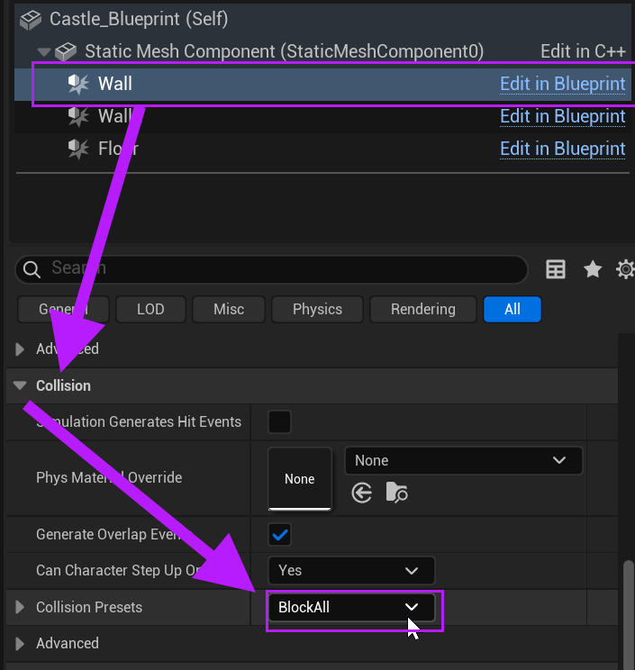

# Unreal: Geometry: Passing through? Add a collision component and set BlockAll!

> Legacy lesson, organized for self-study. Screenshots may show an older editor. See the Unreal 5.8 verification scope (legacy attachment omitted) before relying on version-specific steps.

By default, complex geometries will not have a set collision if Unreal cannot easily figure it out. To help with this, we can add collision components to an actor.

*Figure: Screenshot of collisions (box, capsule, and sphere) components.*

By default, an added collision of be of its default (smaller) scale (1, 1, 1).

*Figure: Screenshot highlighting the use of the Transform tool or Transform values for arranging and changing scale of an actor.*

To create blocking for a collision component, set its preset to "BlockAll"

*Figure: Screenshot showing the process of setting the presets to "BlockAll"*

If needed, you can add multiple collision components to an actor. Feel free to add as many as needed!
