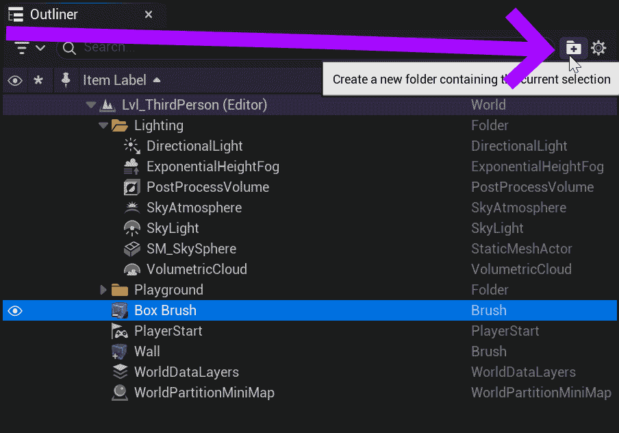
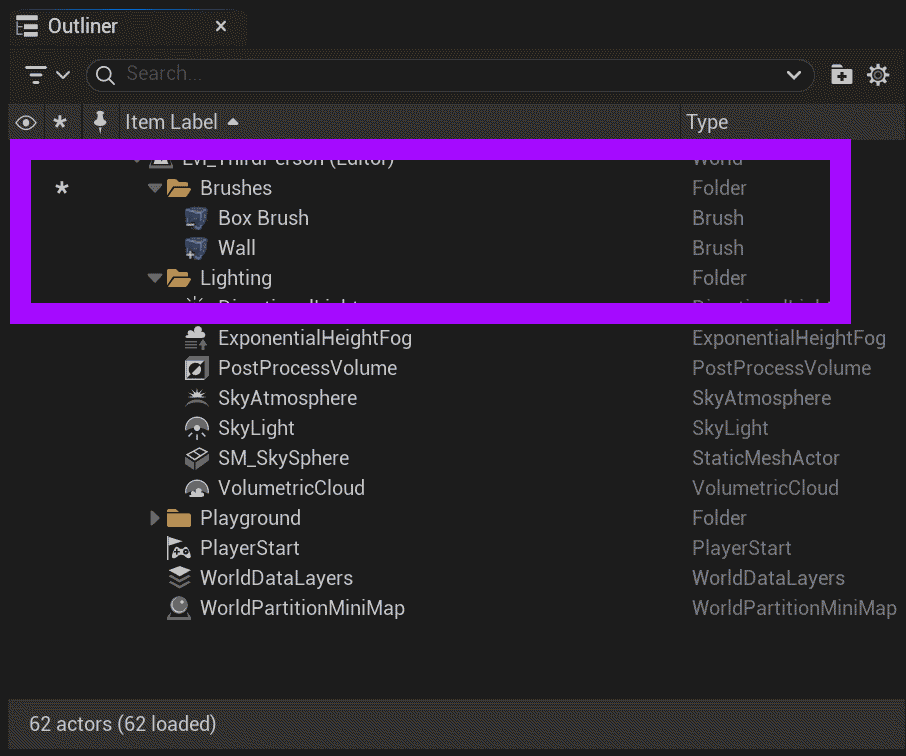

# Unreal: Organizing Actors into Folders

> Legacy lesson, organized for self-study. Screenshots may show an older editor. See the Unreal 5.8 verification scope (legacy attachment omitted) before relying on version-specific steps.

In the Outliner tab, we can create folders to help us better organize actors.

**(Placing an Actor in a folder does not affect any values other than for developer organization purposes.)**

*Figure: Screenshot highlighting "Create a new folder" button in the Outliner tab.*

Clicking and dragging actors into folders.

*Figure: Screenshot highlighting Brushes collected under a folder named "Brushes".*
