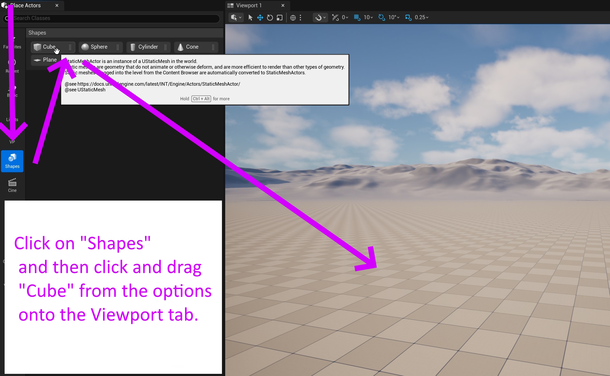
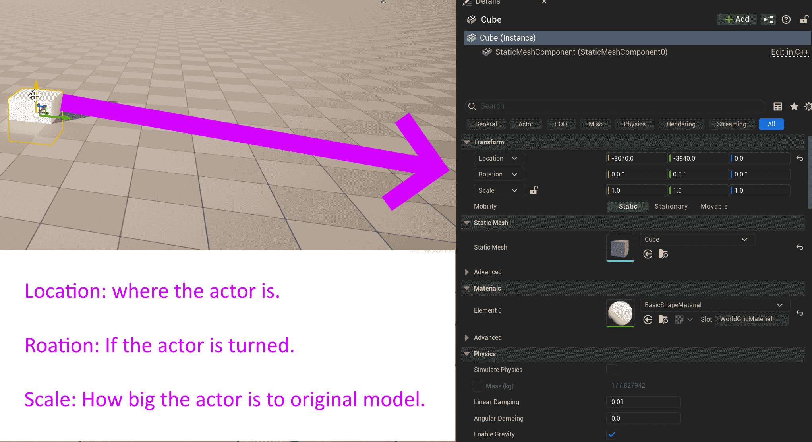

# Unreal: Placing a Cube

> Legacy lesson, organized for self-study. Screenshots may show an older editor. See the Unreal 5.8 verification scope (legacy attachment omitted) before relying on version-specific steps.

One of the most common user actions in the Unreal Editor is the placement or adjustment of an Actor.

Let's practice this using a common shape in Unreal, a Cube.

## Finding a Cube

In the default layout, a Cube can be found in the Shapes category and then clicking and dragging "Cube" from the options into the Viewport tab in the middle of the screen.

*Figure: Screenshot of selecting a "Cube" from the Place Actors tab in the Unreal Editor*

When an Actor is first placed in the level, Unreal will automatically select in the Outliner tab and show its components in the Details tab.

*Figure: Screenshot of Unreal Editor show the Transform component of a Cube actor.*

## Reviewing Common Components

Every Actor shares a common component named *Transform*. This has three values:

- Location: Where the Actor is currently in a level.
- Rotation: If the Actor is currently turned.
- Scale: How large (relative to its original shape) the Actor currently is.

When we add a shape from the Place Actor tab, the Actor will also be a *static mesh*.

**Note**: In mathematics, a *mesh* is a a geometric shape that can be represented in triangles. This is important, as computers can draw triangles the fastest!

The term *static mesh* in Unreal means two important things for us right now. The first is that it is a mesh, or geometric shape, taking up space in the level and two, that the shape is static, which means it will not move by default.
