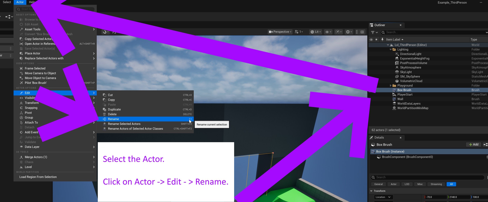
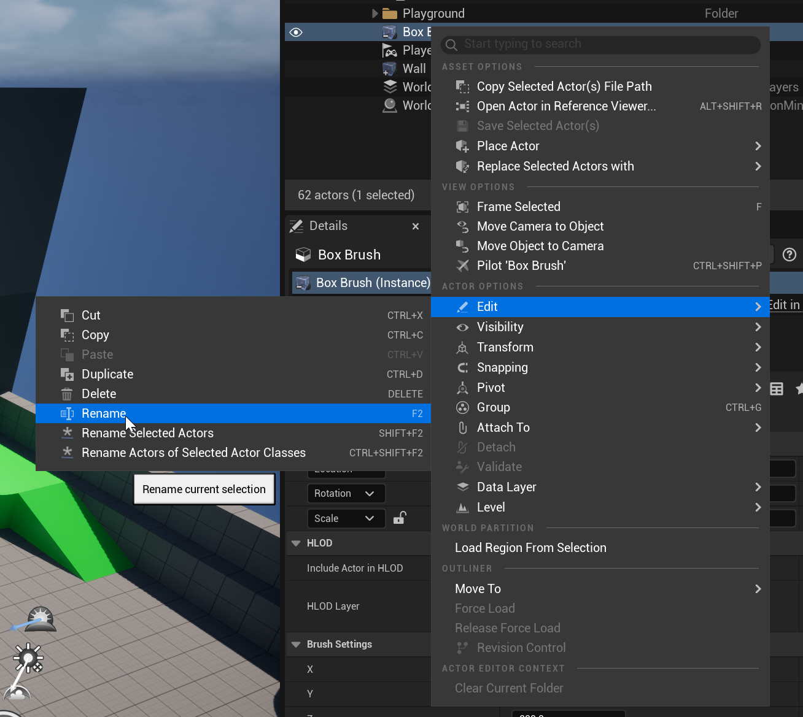

# Unreal: Renaming Actors

> Legacy lesson, organized for self-study. Screenshots may show an older editor. See the Unreal 5.8 verification scope (legacy attachment omitted) before relying on version-specific steps.

When we place actors in a level, Unreal will automatically create a name for it. Often, we do not want to use these default names.

## Renaming an Actor

To re-name an Actor, we need to first select it in the Outliner.

Next, we can approach the action in two possible ways.

One way we can rename an Actor is through using the Actor menu, selecting Actor -\> Edit -\> Rename and then entering a new name.

*Figure: Screenshot of Re-naming process using Actor menu.*

Alternatively, we can right-click on an actor and then use Edit -\> Rename.

*Figure: Screenshot showing the right-click menu for renaming.*
