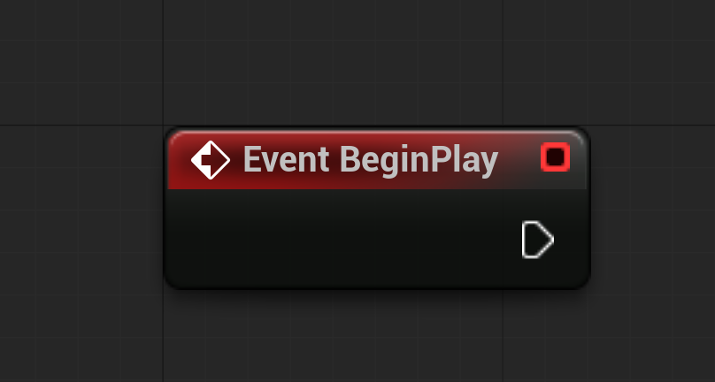
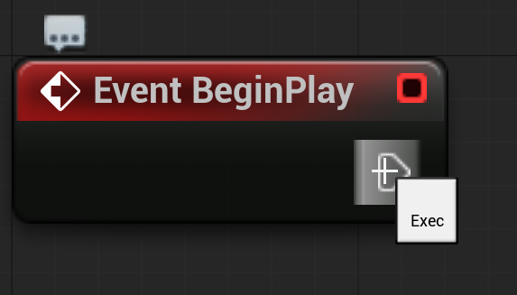
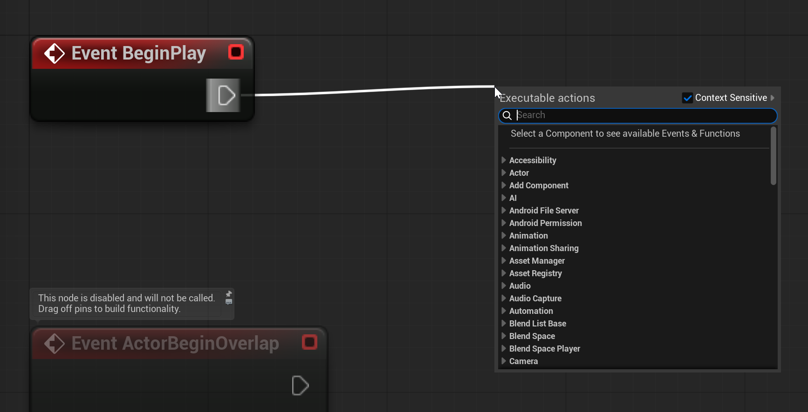
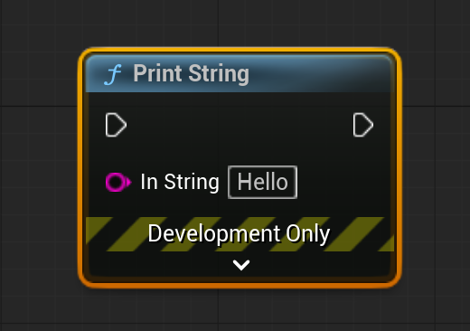

# Unreal: Blueprints: Anatomy of a Node

> Legacy lesson, organized for self-study. Screenshots may show an older editor. See the Unreal 5.8 verification scope (legacy attachment omitted) before relying on version-specific steps.

Blueprints is a visual scripting language. This means visual aspects, code, directionality, and the use of "wires" and nodes, show how functionality is connected to each other.

To understand nodes, let's examine two of the most common types, Event and Function.

## Example: Red Event Nodes

Every type of node in Blueprints is color-coded. Events are red.

Events nodes begin with the word "Event" and then the name of the event. For example, a common event is "BeginPlay", which every Actor has access to as part of their own Event Graph.

*Figure: Screenshot of Event Node in Event Graph.*

On the right-hand side of every node is a white arrow pointing to the right. This is the **Exec** pin. It *executes* the next node in sequence.

*Figure: Screenshot of an "Exec" pin on an Event node.*

We connect one node to another through an action called "pulling off" the node. We click and drag a wire out to an open space in the Event Graph. This will open a menu with options to add the next node in sequence.

*Figure: Screenshot of "pulling off" the Exec output pin of an Event node.*

It is very common to "begin" a sequence of nodes in Blueprints with an Event node. In fact, that is why the tab is called the *Event* Graph. We almost always start with an event and then do something in response using different nodes.

## Example: Blue Function Node

A Function is blue. It takes its name from *functionality* programmed into Unreal. When we want to process data in some way, we usually want a function, and when we use a node of this type, it will be blue.

*Figure: Screenshot of the "Print String" Function node in the Event Graph.*

We usually begin a sequence of nodes in Unreal with an Event node. This is then followed by other nodes.

Because a Function node is in the "middle" of some sequence, it has two Exec pins. On the left-hand side is the input pin and on the right-hand side is the output pin.

The left-hand side Exec pin connects it to some other node from the left and the right-hand side output Exec pin points toward the next in the sequence.

The Print String node in Blueprints can also accept data. The first is an input pin for data of the String type. In Blueprints, all String data is pink.
