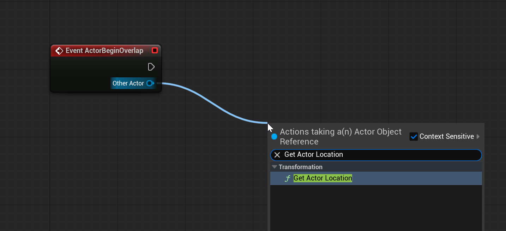
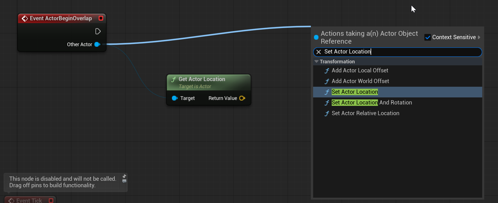
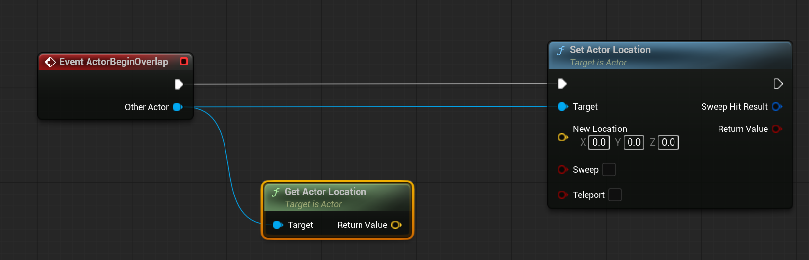
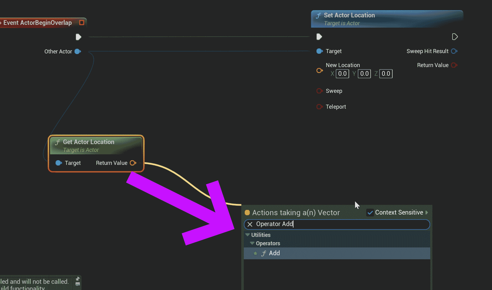
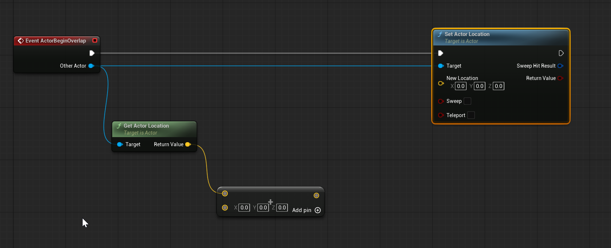
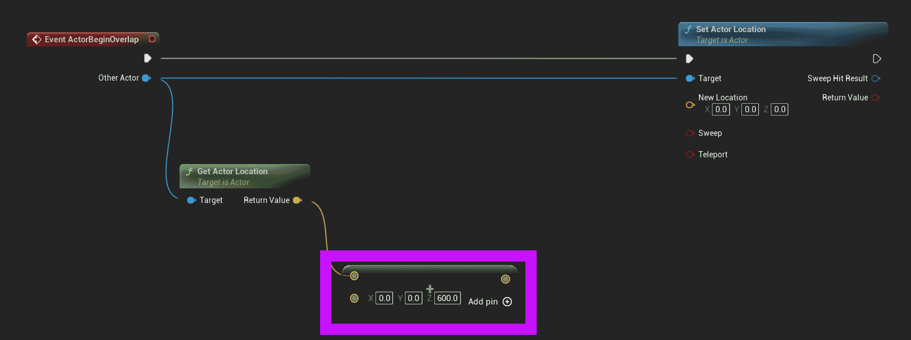
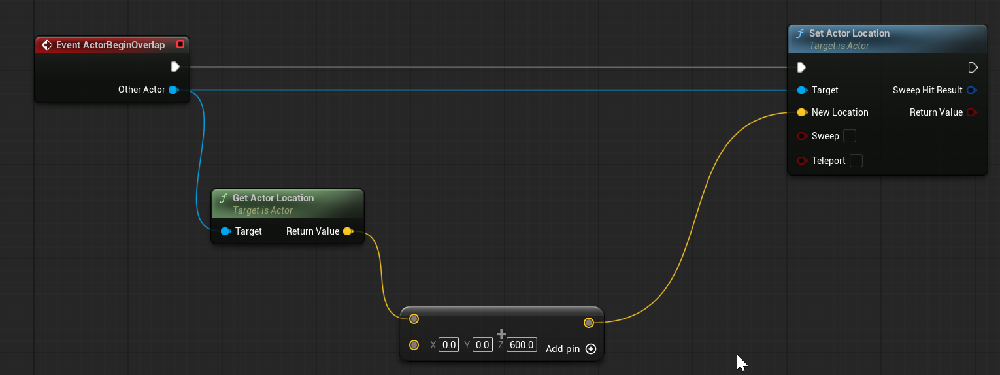
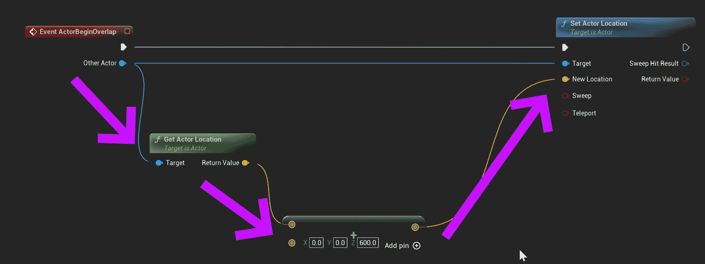

# Unreal: Blueprints: "Getting" and "Setting" Actor Values

> Legacy lesson, organized for self-study. Screenshots may show an older editor. See the Unreal 5.8 verification scope (legacy attachment omitted) before relying on version-specific steps.

As it comes to events, we are often "pulling off" data passed to the event from systems. These nodes generally fall into two rough categories when working with another actor.

We either want to do two things in connect to another actor:

- Get: Access data.
- Set: Update data.

In Blueprints, there is a major difference between their nodes. **Only *Set* nodes have an Exec pin.**

## Example: Changing an Overlapping Actor's Location

To better understand this relationship, let's look at an example of a "bounce pad." In this example, if an actor overlaps with the trigger box, it will send the overlapping actor upwards 600 values on the z-axis.

By pulling off the *Other Actor* output pin of a BeginPlay node, we can access its location using the Get Actor Location node.

*Figure: Screenshot of showing a search for "Get Actor Location" node.*

The Get Actor Location node does not have an Exec pin. It is not considered the "next" node in a sequence.

To make the next node in the sequence, we need to go back to the ActorBeginOverlap node and pull off another node. This time, we will create a Set Actor Location node.

*Figure: Screenshot of connecting wires of multiple node sequence in Event Graph.*

With both the Get Actor Location and Set Actor Location nodes added, the sequence may look strange at first. However, this is a very common pattern to programming in Blueprints. We will often see "spaghetti" code as wires connect different nodes in a sequence.

*Figure: Screenshot of both Get Actor Location and Set Actor Location nodes in the Event Graph.*

Notice, once added, the Exec output pin of the Actor Begin Overlap node is connected to the input Exec pin of the Set Actor Location node. This means they will run in sequence, one after the other.

To affect the position, we need to *add* to the actor's location and then update the location as part of the Set Actor Location node. To do this, we need to pull off the *Return Value* pin of the Get Actor Location node and search for the "Add" operator.

*Figure: Screenshot of searching for "Operator Add" node.*

This may seem confusing at first and prompt the question "What is an operator?" Unreal borrows from the technical term in mathematics.

**An operator is a symbol that produces a new value from two previous values. A common example is the addition symbol, "+", which adds numbers together.**

In Unreal, we can ask for the *operator* and then what *operation* we want to perform. Unreal understands the context we want and will produce a node matching the data type we are working within based on its color.

*Figure: Screenshot of Get Actor Location node connected to Operator Add node.*

In mathematics, addition performs actions from left to right. The same is also true in Blueprints. The "left" number is what is being passed from the Get Actor Location node, the current location of the overlapping actor. The "right" number is whatever we enter in the X, Y, and Z values of the Operator Add node.

In this example, we want to create a "bounce" effect by sending an actor up into the air. To do this, we will add 600 to the z-axis (the default up and down axis in Unreal).

*Figure: Screenshot of changed z-axis value in Operator Add node.*

With both left and right values for the Operator Add node, we can connect this node back to the Set Actor Location for its input pin for the New Location value.

*Figure: Screenshot of connected Get Actor Location to Operator Add to Set Actor Location sequence.*

Connected together, it may seem strange to figure out the order. What runs first? The "get" or the "set"?

**In Blueprints, any nodes between one node with a Exec pin and the next will be run *first*.**

In this example, because the Get Actor Location and Operator Add nodes are between the Actor Begin Overlap and the Set Actor Location will be run first with the Set Actor Location node run last in the sequence.

*Figure: Screenshot of execution order of node sequence.*
