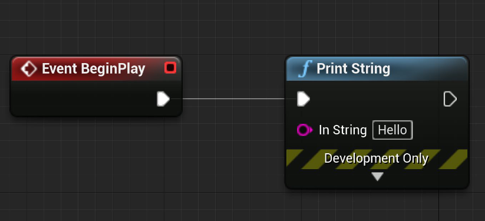

# Unreal: Blueprints: Graphs and Nodes

> Legacy lesson, organized for self-study. Screenshots may show an older editor. See the Unreal 5.8 verification scope (legacy attachment omitted) before relying on version-specific steps.

Blueprints is a *visual* scripting language. This is very different than working with most other programming languages. Rather than using lines of code, we program graphs, sequences of nodes, with pins, how data is passed between them.

## Graphs

When working with Blueprints, we are editing their *graphs.* Generally, every Actor will have at least one graph, their **Event Graph**. Unreal uses a event-based architecture. This means mechanics start with an event and proceed from left to right between functionality represented as nodes.

## Nodes

Functionality is broken into *nodes*. These have colors and icons representing their type. Event nodes are red and functions are light blue, for example. The icon representing a function has a small, cursive 'f' letter.

*Figure: Screenshot of EventGraph showing two nodes.*

## Node Breakdown

Nodes have up to three parts:

- Input Pins
- Type (connected to color)
- Output Pins

Nodes are connected in sequence. To build a connection, a wire is dragged from one pin to another. If connected, functionality will flow from one node to the next from left to right.

To send data from one node to another, the output pin from one node can be connected to the data pin of another. When run, data will be sent between them.
