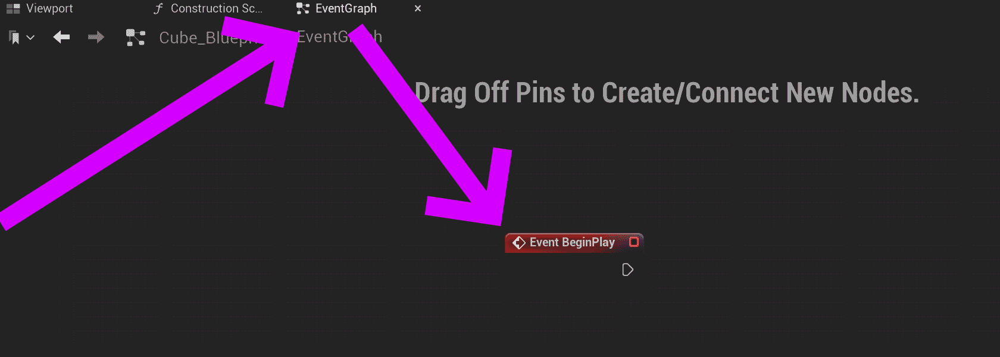
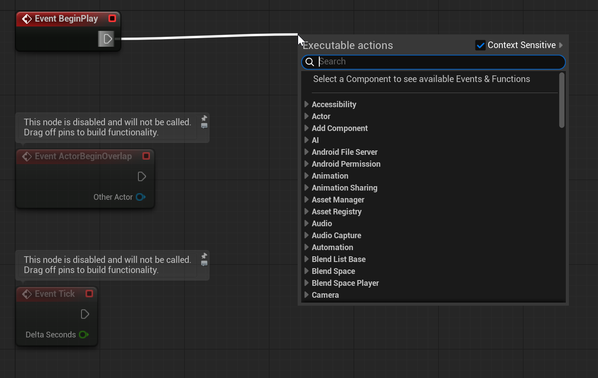
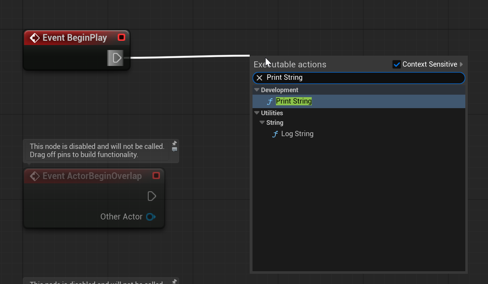
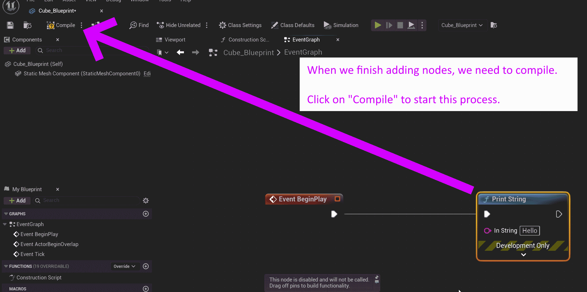
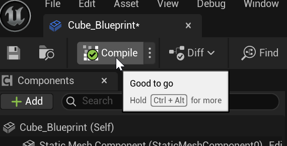
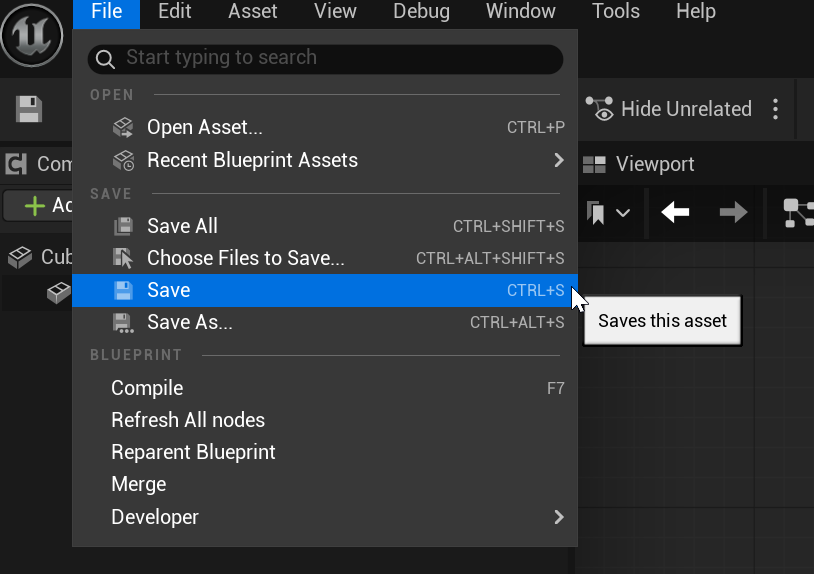

# Unreal: Blueprints: Reacting to the beginning of play (BeginPlay)

> Legacy lesson, organized for self-study. Screenshots may show an older editor. See the Unreal 5.8 verification scope (legacy attachment omitted) before relying on version-specific steps.

An Event node is a red node in Unreal. It is a response to something happening in a system.

Every Actor has access to an event named BeginPlay. This happens when "play" begins in a level. When it is loaded, it tells all of its actors that play has now begun.

*Figure: Screenshot of EventGraph in Blueprint Editor showing the "Event BeginPlay" node.*

We connect nodes by "pulling off" a wire from the output execution pin and attaching it to another node's input execution node.

*Figure: Screenshot showing the action of "pulling" a wire from the execution output pin.*

In the menu, if we type "Print String", we will find a useful node for showing messages to ourselves during development.

*Figure: Screenshot of finding the "Print String" node in the context menu.*

From this point, we can click on the name in the listing or press ENTER to produce the node on the graph.

*Figure: Screenshot showing the "Compile" button in the Blueprint Editor.*

If the compile was successful, a green check mark will appear on the icon.

*Figure: Screenshot of valid compilation in the Blueprint Editor.*

Finally, we need to save the changed blueprint. We can do this through File -\> Save. (The Blueprint Editor does not automatically save, but Unreal does auto-save some things.)

*Figure: Screenshot of File -\> Save menu in Blueprint Editor.*

Once the file has been save, the Blueprint Editor can be closed.
