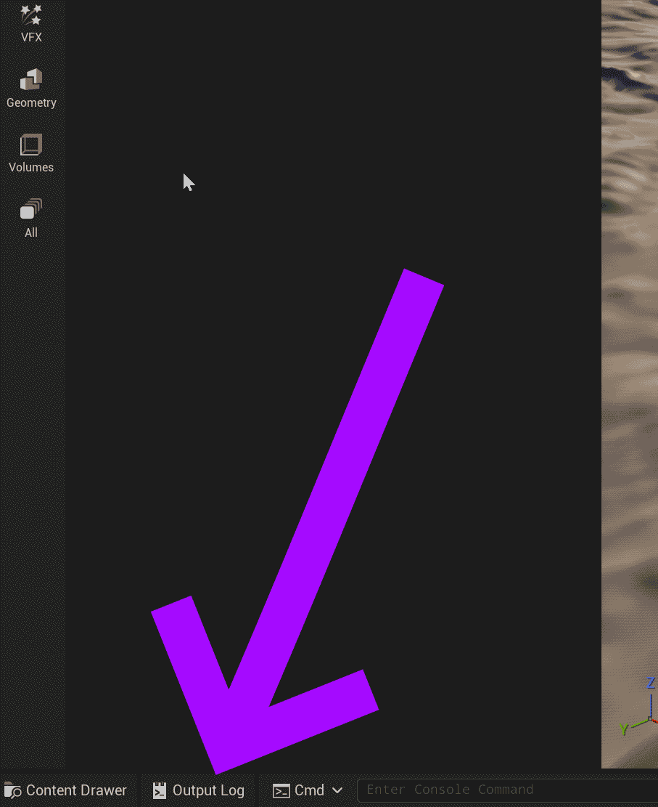
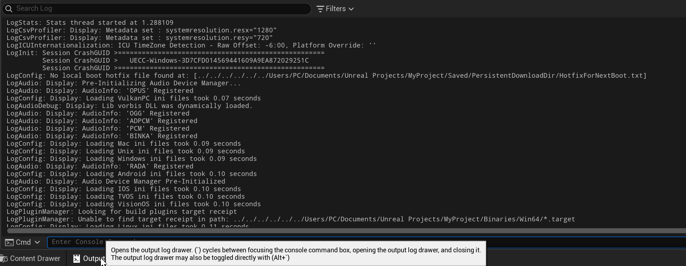
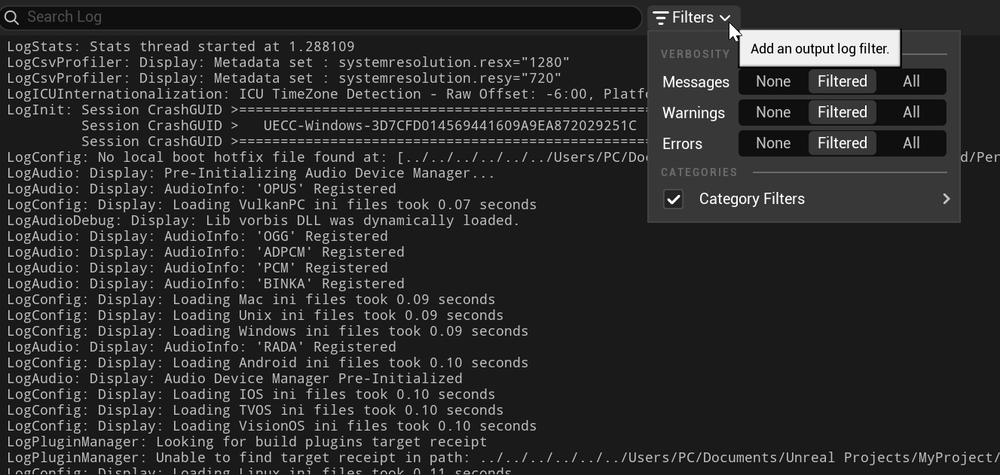
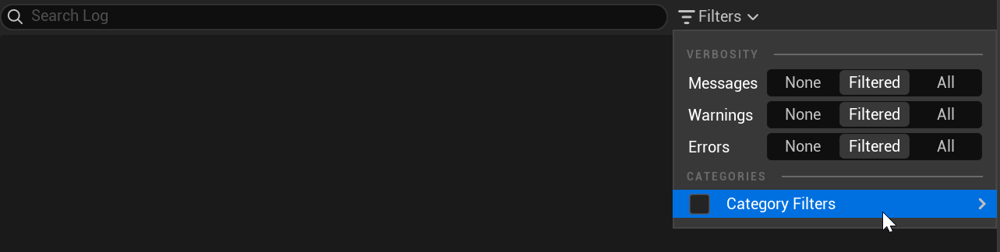
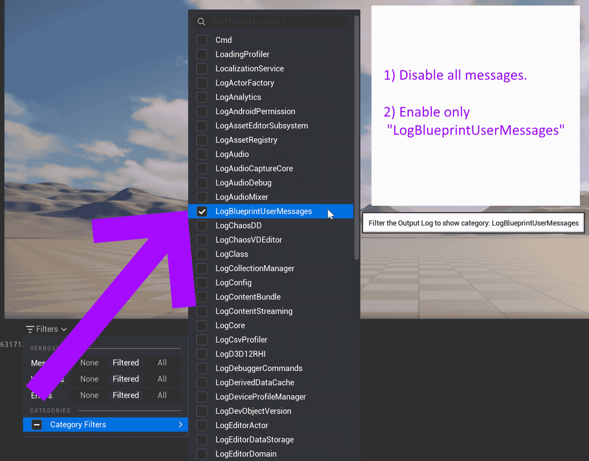
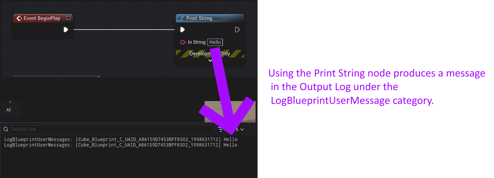

# Unreal: Blueprints: Reading the Output Log

> Legacy lesson, organized for self-study. Screenshots may show an older editor. See the Unreal 5.8 verification scope (legacy attachment omitted) before relying on version-specific steps.

## *What is the Output Log?*

When we work with a game engine, we often want messages about the status of different systems and if any errors were encountered when running code. In Unreal, we call this functionality the **Output Log**.

In the default layout, the Output Log drawer can be found in the lower, left-hand corner.

*Figure: Screenshot showing the "Output Log" in the bottom, left-hand corner.*

Clicking on the Output Log drawer will show a large amount of information by default.

*Figure: Screenshot of Output Log drawer content showing all messages.*

Clicking on the Filters menu can help in telling Unreal not to show all messages from all systems.

*Figure: Screenshot of Filters menu in the Output Log drawer.*

In the Filters menu, click on the checkbox next to "Category Filters" to filter out everything initially.

*Figure: Screenshot showing no messages in the Output Log drawer.*

With all messages filtered out, we can select only the type of messages we want to see. This can help us work only some systems and functionality like the Print String node.

## Showing Only Print String Messages

The Print String node will show a message in the Output Log. However, it can often be hard to see its messages when other systems also show their own messages. To improve this, we will disable all messages and then enable only the "LogBlueprintUserMessages" option.

*Figure: Screenshot showing "LogBlueprintUserMessage" selected in the Category Filter listing.*

With only "LogBlueprintUserMessage" selected, any uses of the Print String node will more easily show up in the Output Log.

*Figure: Connected Screenshots Demonstrating Connection Between Print String and Output Log.*
