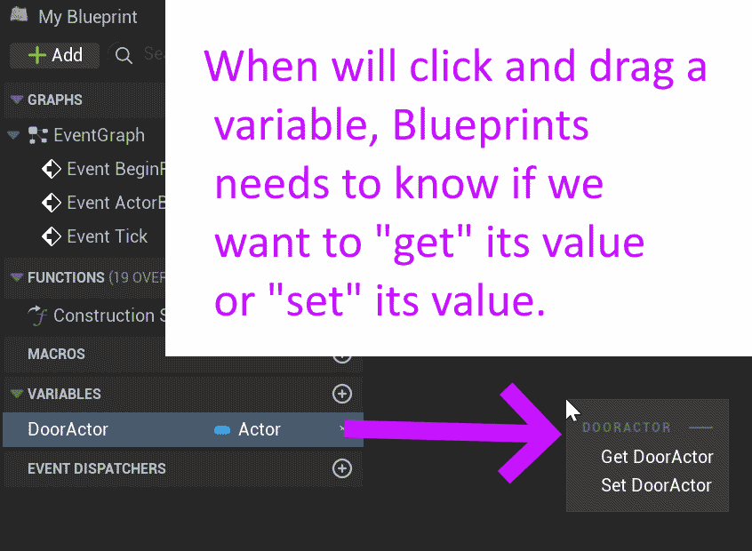

# Unreal: Blueprints: Variables: Getting and Setting Values

> Legacy lesson, organized for self-study. Screenshots may show an older editor. See the Unreal 5.8 verification scope (legacy attachment omitted) before relying on version-specific steps.

Once we add a variable to a blueprint, it becomes something we can "drop" into a sequence of nodes. However, how we would with the variable depends on what kind of actions we want to performs. As we saw with values, we can "get" or "set" them. This is also true of a variable, which is a human-readable name for a computer-readable *value*.

When we click and drag a variable onto the Event Graph, we are given an option of "get" or "set".

*Figure: Screenshot showcasing the "Get" and "Set" actions for a variable in the Event Graph.*

## *Why is "get" and "set" important for variables?*

We have already seen that only Set node have an Exec pin. This means they are the next "execution" in some sequence. When we work with variables, which are values, Blueprints need to know the next node in sequence that will be "executed." If we pick that we want to perform a "set" action, this will become the next node with an Exec pin. A "get" node does not have one.
