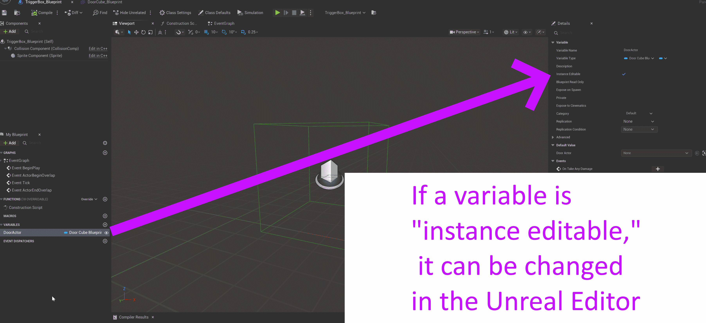
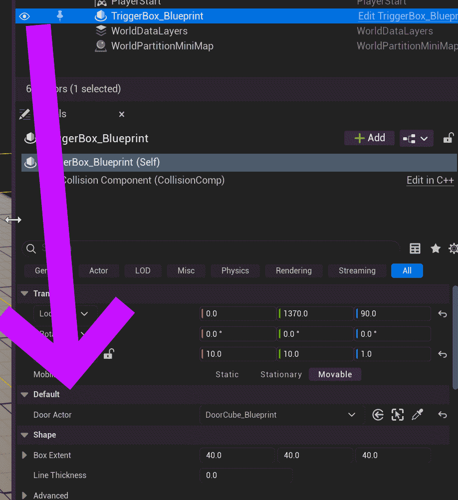

# Unreal: Blueprints: Variables: Using "Instance Editable" to update values in Unreal Editor directly

> Legacy lesson, organized for self-study. Screenshots may show an older editor. See the Unreal 5.8 verification scope (legacy attachment omitted) before relying on version-specific steps.

We often want to edit values within the Blueprint Editor. However, in some cases, we might have another actor in a level we want to use as a value but it is not defined within the blueprint of the current actor. In these cases, we can use a special value known as *Instance Editable*.

## Updating Instance Editable

*Figure: Screenshot of "Instance Editable" field for an example variable in the Blueprint Editor.*

When checked, the Instance Editable value adds an entry in a *Default* component for the actor. When viewed in the Details tab (listing its components and their value), a new section name "Default" will appear with the name of the variable.

*Figure: Screenshot of Default component for an Actor in the Details tab.*

Depending the type of the variable, different options may be available. For actors, for example, a drop-down list will be presented to select one from the current level.
