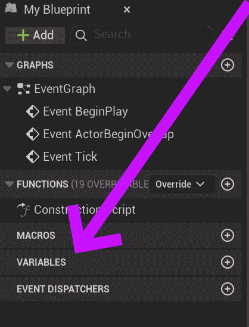
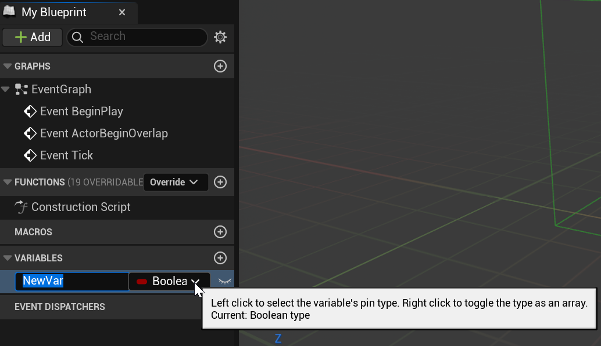
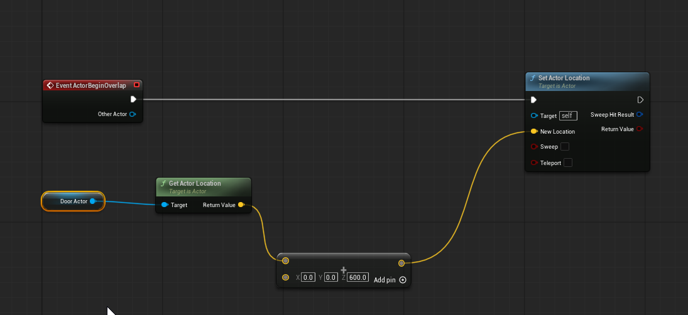

# Unreal: Blueprints: Variables: What is a variable?

> Legacy lesson, organized for self-study. Screenshots may show an older editor. See the Unreal 5.8 verification scope (legacy attachment omitted) before relying on version-specific steps.

In programming languages, we call the concept of saving values a **variable**. This allow us to give a human-readable name to a computer-readable value.

**In Blueprints, a *variable* is defined as a value we can "drop in" as part of a sequence when we need it. It becomes part of the blueprint, and can be changed during and across event sequences.**

## *Why do we need variables?*

There are many occasions when working with overlap events can be very helpful. We can pull off the *Other Actor* pin and perform some action on the values of the actor. However, there are also occasions where we want to affect something else in a level without it currently being overlapping with another actor. For these purposes, we need to know the "target" of the actions in terms of a variable we set and whose value we prepare.

## *Where are variables in Blueprints?*

With the Blueprint Editor open for a blueprint, we can find in the default layout the My Blueprint tab and in its listing the "Variables" section.

*Figure: Screenshot of My Blueprint tab in the Blueprint Editor.*

By clicking on the plus symbol, "+", for the section, we can add and name a variable.

*Figure: Screenshot of creating a new Blueprints variable.*

## *How do we use variables?*

If we have defined a variable, we can drag and drop it into the Event Graph. It then becomes something we can pull off to use its value when needed.

For example, instead of affecting the overlapping actor in the "bounce pad" example, we could affect a saved value of another actor in the level instead.

*Figure: Screenshot of using the value of a variable as part of a node sequence.*
