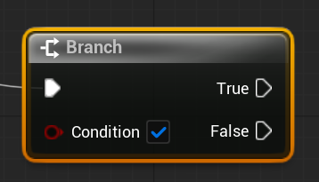
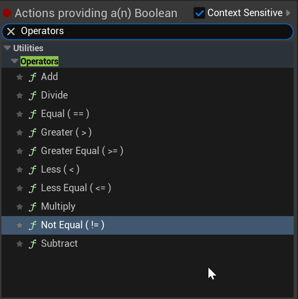

# Unreal: Flow Control: Conditional Sequences

> Legacy lesson, organized for self-study. Screenshots may show an older editor. See the Unreal 5.8 verification scope (legacy attachment omitted) before relying on version-specific steps.

As we program sequences of nodes in Blueprints, we often want to compare values and then run a different sequence of nodes. In more traditional programming languages, this pattern would be called **conditional statement**. Based on a comparison, one of more "branches" of code would be run.

Borrowing this concept of a "branch," Blueprints has a node named [**Branch**](https://dev.epicgames.com/documentation/en-us/unreal-engine/BlueprintAPI/Utilities/FlowControl/Branch).

*Figure: Screenshot of the Branch node in Blueprints.*

## Branch Node Needs a Condition

The Branch node works on an input pin named *Condition*. It needs to know what the comparison is!

Blueprints has a set of nodes named Operators to work on two or more values. Of these, there are the familiar equal-to, less-than, and others.

*Figure: Screenshot of operators in Blueprints.*
