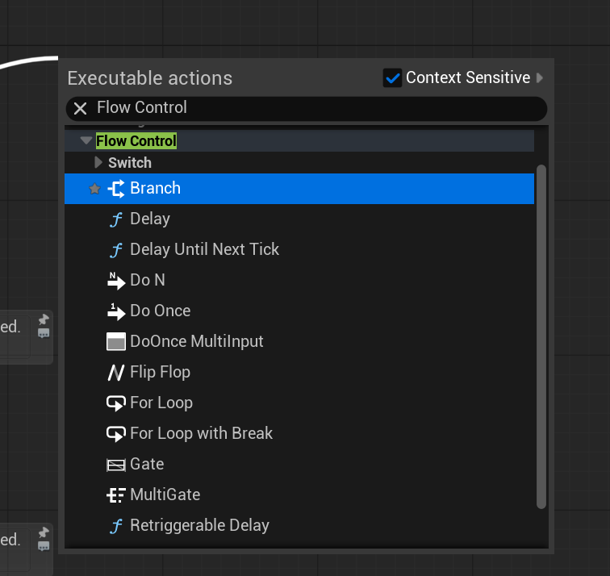

# Unreal: Flow Control: What is flow?

> Legacy lesson, organized for self-study. Screenshots may show an older editor. See the Unreal 5.8 verification scope (legacy attachment omitted) before relying on version-specific steps.

In Blueprints, we often discuss sequences of nodes. As our code becomes more complex, and we have longer sequences of nodes, we often need a word to describe the movement of functionality from one node to the next. We call this **flow**.

The use of the word **flow** should bring to mind the movement of liquids from one location to another. Like liquids, our sequences of nodes also "flow" from the execution pin of one node to another.

As we make more complex sequences, we often want to control this flow. This gives rise to a collection of nodes named the same, "Flow Control"

*Figure: Screenshot of "Flow Control" listing of nodes.*

Flow Control nodes allow us to "control" the sequence of nodes and how actions are taken. These provide us functionality for different types of looping behavior, how many times certain nodes should be run, and if some nodes should be prevented from being run at all in a sequence based on some condition.
