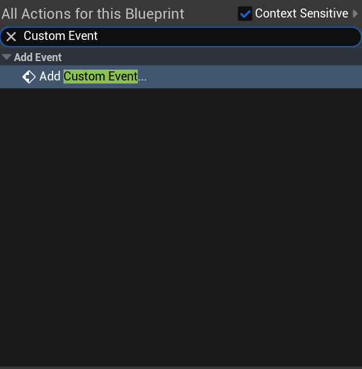
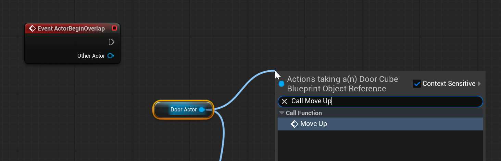
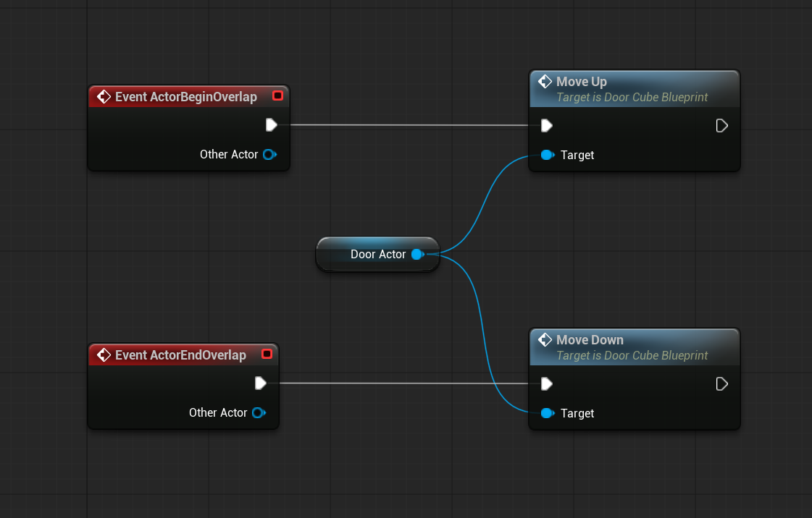
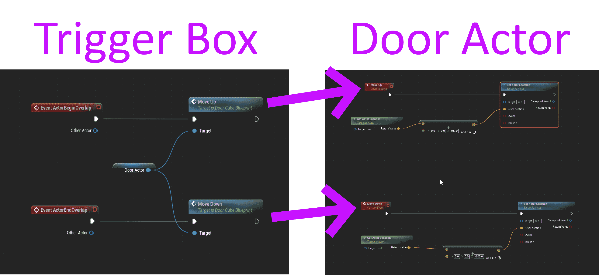

# Unreal: Blueprints: Actor Communication: Save to variable and trigger its own events

> Legacy lesson, organized for self-study. Screenshots may show an older editor. See the Unreal 5.8 verification scope (legacy attachment omitted) before relying on version-specific steps.

**If one or more actors DO share an event, the easiest approach is to access the actor directly.**

**If one or more actors DO NOT share an event, you can create a variable, save the actor's value, and access its values**.

**If one or more actors DO NOT share an event, you can create a variable, save the actor's value, and trigger its own events.**

## Reviewing Events

Blueprints is event-based. This may seem a silly thing to point out, but this is a central aspect of its design. After all, we use the *Event* Graph to create sequences of nodes. As part of this, we can use defined events like Tick and ActorBeginOverlap.

We can also define *custom* events.

In any Event Graph, we can create a new, custom event by searching for the "Add Custom Event" node in an Event Graph.

*Figure: Screenshot showing "Add Custom Event" node for the Event Graph.*

We can name this event anything we want.

From this custom event, we can define a new sequence of nodes.

To use a custom event in another Event Graph, Blueprints needs to know "where" it is defined. This requires us to still save a variable of some type of an actor in a level, but we do not change its values directly. Instead, we "call" its events.

## Example: Calling Events in another Actor's Event Graph

We can define as many custom events as we want.

As long as one actor knows "where" (attached to what other actor) the custom events are defined, they can call them.

In Blueprints, the term "call" is used in this context. If an actor has a custom event, we "call" it.

*Figure: Screenshot of "Call" option for a Custom Event defined in another Actor's Event Graph.*

In this example, I have defined a variable **Door Actor** of a type matching an existing actor in a level. When a player-character triggers the BeginOverlap event, it calls the "Move Up" custom event of the door actor. When the player-character triggers the EndOverlap event, it calls the "Move Down" custom event of the door actor.

*Figure: Screenshot of calling different custom events in another actor's Event Graph.*

For the door actor, I have defined two custom events. One moves its own position "up" up 600. The other moves the door back "down" 600.

Because of the custom events, these are connected.

*Figure: Screenshot showing connection between example Trigger Box and Door Actor.*
