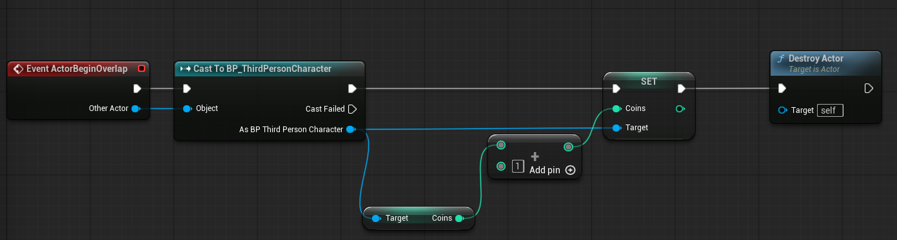

# Unreal: Blueprints: Collectables (Destroy on Collision Enter)

> Legacy lesson, organized for self-study. Screenshots may show an older editor. See the Unreal 5.8 verification scope (legacy attachment omitted) before relying on version-specific steps.

Let's assume you have an actor in a level. This actor is some collectable the player-character should interact with by colliding with it (such as health, coins, etc.).

Next, let's assume that the player-character (BP_ThirdPersonCharacter in this example) has an instance editable variable named *Coins*.

What should happen is that, for every "coin collected", the amount should increase.

*Figure: Screenshot of node sequence for accessing the variable of a Blueprint, increasing it by one, and then destroying the actor.*
