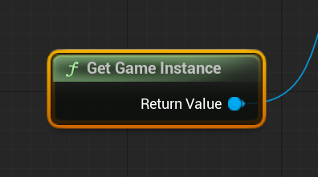
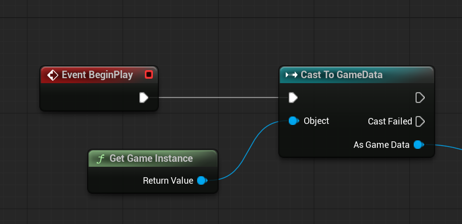

# Unreal: Blueprints: Game Instance: Accessing Game Instance from other Blueprints

> Legacy lesson, organized for self-study. Screenshots may show an older editor. See the Unreal 5.8 verification scope (legacy attachment omitted) before relying on version-specific steps.

We often want to save data and then access it across levels. While there are some different approaches to this, one of the easiest is to add variables to the Game Instance.

This may seem strange, but there is a very useful node in Unreal to give any actor any access to a Game Instance: **Get Game Instance**.

*Figure: Screenshot of Get Game Instance node.*

Like with doing things with our Player Character (which is an instance of Actor), we need to cast to the name of the Blueprint.

*Figure: Screenshot of Get Game Instance to Cast To nodes.*

Anything we can do "As" another Blueprint, we can do with the Game Instance Blueprint. This includes accessing its variables or triggering its events.
