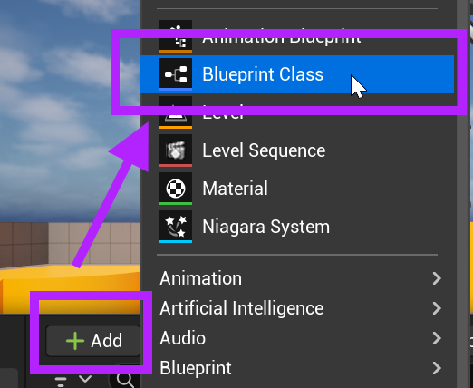
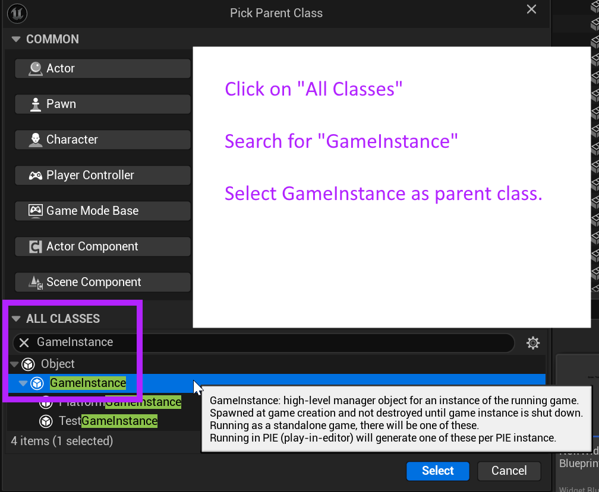
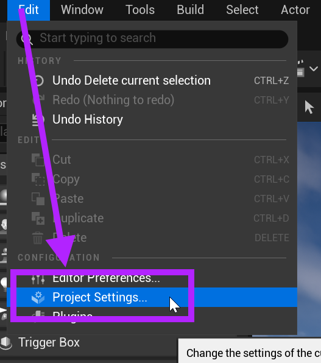
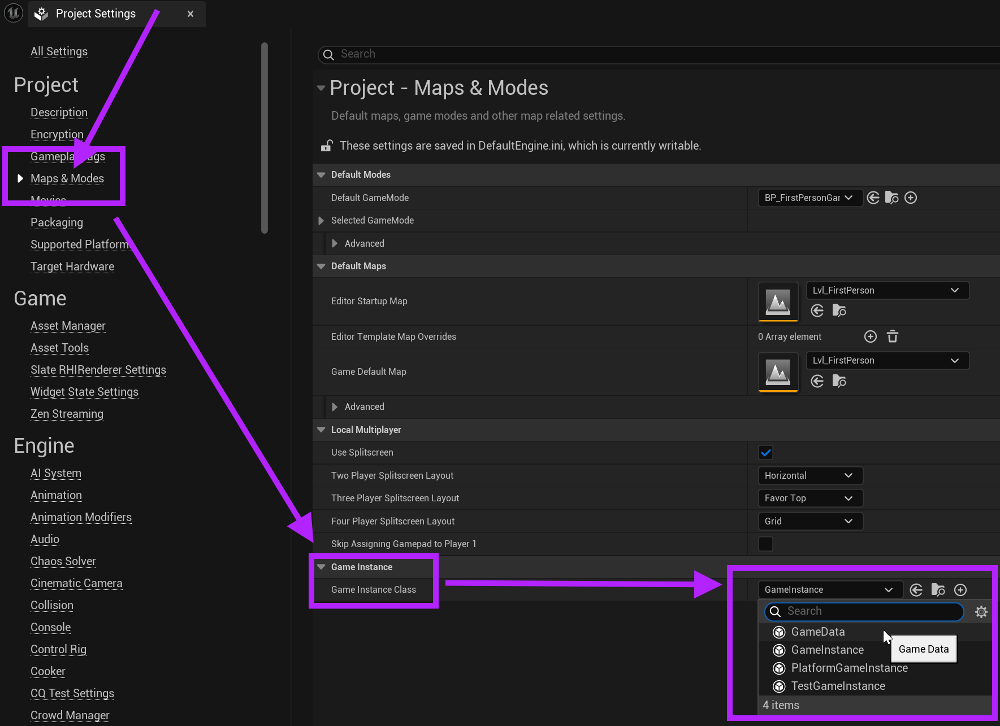

# Unreal: Blueprints: Game Instance: What is the Game Instance?

> Legacy lesson, organized for self-study. Screenshots may show an older editor. See the Unreal 5.8 verification scope (legacy attachment omitted) before relying on version-specific steps.

Like a level or actor, we can create an *instance* of the game. This allows us to store global data and access it across things like levels, actors, and widgets.

## Creating a Game Instance Blueprint

Just like we have been doing for levels, we start with the Content Drawer. Using either "+Add" or right-clicking. Next, select "Blueprint Class":

*Figure: Screenshot highlighting creating a new Blueprint class in the Content Drawer.*

There are many possible classes available to use in Unreal. We want GameInstance. Type in "GameInstance" in the search and then select it from the list. **(Do not select PlatformGameInstance! This is a special class designed for mobile platforms.)**

*Figure: Screenshot of creating a parent class of Game Instance.*

Searching for "GameInstance" for classes.

Click on "Select".

Change the name to something useful. This might be the name of the game, include the words "game instance," or use something else.

## Changing Project Settings

In order to use a new Game Instance class, the settings for the project must be changed.

In the Unreal Editor, go to Edit → Project Settings…

*Figure: Screenshot showing Edit -\> Project Settings...*

In Project Settings, click on Maps & Modes from the left-hand side.

At the very bottom of the options will be one for Game Instance.

Click on the drop-down menu with the word "Game Instance".

Using either the search bar or the listing, click on the name of the created blueprint.

*Figure: Screenshot highlighting process of setting a Game Instance class.*

Once this has been selected, it is will saved. The Project Settings window can now be closed.

As the name Game Instance class, the created Blueprint can be used as if it was the default, but because we created it in the Content Drawer, we can also open it as if it was any other blueprint to add code or variables as needed.
