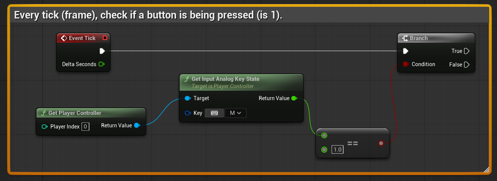

# Unreal: Blueprints: Global: Get Player Controller

> Legacy lesson, organized for self-study. Screenshots may show an older editor. See the Unreal 5.8 verification scope (legacy attachment omitted) before relying on version-specific steps.

Anything having to do with player input comes through a Blueprint named [Player Controller](https://dev.epicgames.com/documentation/en-us/unreal-engine/player-controllers-in-unreal-engine). Internally, this Blueprint has a list of inputs (keys pressed on a keyword, buttons on a gamepad) defined in an asset and then uses events to pass data on what happens to other code.

Because the Player Controller handles everything, we need to go through it for actions like hiding and showing the mouse cursor.

## Example: Asking Player Controller if button pressed

*Figure: Screenshot of example sequence checking every tick (frame) if button is pressed.*
