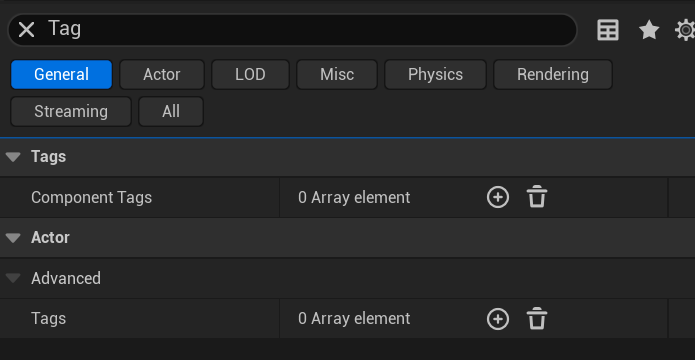
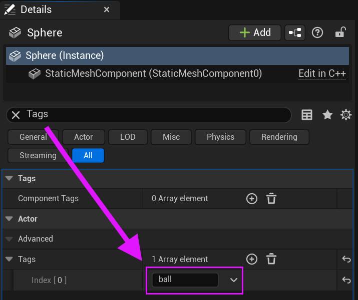
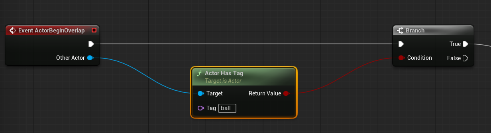

# Unreal: Example: Branch on Collision (Actor Has Tag)

> Legacy lesson, organized for self-study. Screenshots may show an older editor. See the Unreal 5.8 verification scope (legacy attachment omitted) before relying on version-specific steps.

Let's consider a common example in a level with multiple moving things. We often want to "filter" based on what is current colliding with something. One way to approach this is to use a Branch node based on information from another node, [Actor Has Tag](https://dev.epicgames.com/documentation/en-us/unreal-engine/BlueprintAPI/Actor/ActorHasTag).

## *What is a tag?*

Every actor in a level can have one or more tags.

Searching for "Tags" in the component search will show the tags section.

*Figure: Screenshot of the Actor -\> Advanced -\> Tags section of components.*

Through adding tags, we can help filter out actors that may be of the same type (static meshes, for example) performing the same general action. With specific tags on them, we can then use the Actor Has Tag node to test if a specific tag is within the collection (array) of tags an actor might have.

*Figure: Screenshot highlighting the use of a tag on an actor named "ball".*

## *How do we use Actor Has Tag?*

The Actor Has Tag node produced a boolean (true or false) value based on if the actor has a tag within its collection or not. If it does, the node will produce a true value pass as output to the next node in sequence.

Commonly, we will pair Actor Has Tag with the Branch node to check and then confirm if an actor has a tag to then immediately act on the information.

*Figure: Screenshot of Actor Has Tag node within a sequence.*
