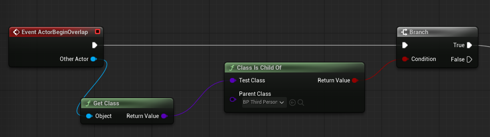

# Unreal: Example: Branch on Collision (Class is Child Of)

> Legacy lesson, organized for self-study. Screenshots may show an older editor. See the Unreal 5.8 verification scope (legacy attachment omitted) before relying on version-specific steps.

Let's consider a common example in a level with multiple moving things. We often want to "filter" based on what is current colliding with something. One way to approach this is to use a Branch node based on information from another node, [**Class is Child Of**](https://dev.epicgames.com/documentation/en-us/unreal-engine/BlueprintAPI/Utilities/ClassIsChildOf).

## *Why do we care about the class?*

For every Blueprint we create, we are also creating a *class*. If this term in unfamiliar, it is the same word we use in object-oriented programming to describe some collection of code. Let me repeat that: **every Blueprint is a class**.

As we create Blueprints, we have classes. This means, as collisions and overlaps happen, we can filter based on the class itself. In other words, we can [Get Class](https://dev.epicgames.com/documentation/en-us/unreal-engine/BlueprintAPI/Utilities/GetClass) and then compare it with something using the Class is Child Of.

*Figure: Screenshot of sequence including a Get Class and Class Is Child Of connected to a Branch node.*

In the included sequence in this example, a Branch node will be considered true if the overlapping actor is of the class "BP_ThirdPersonCharacter" class, which is the default created when using the Third Person template.
