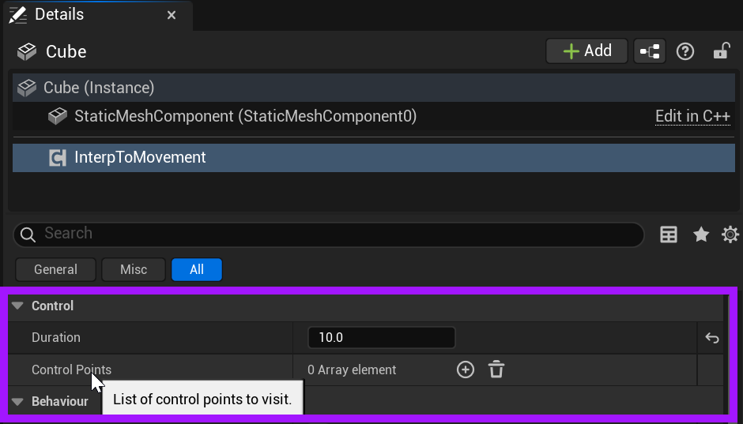
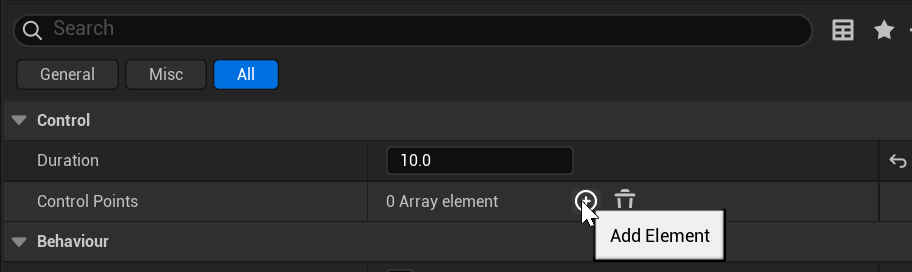
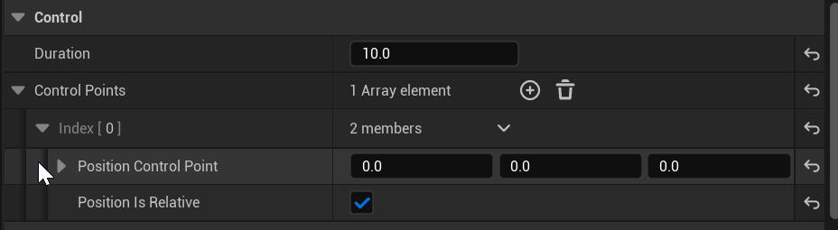
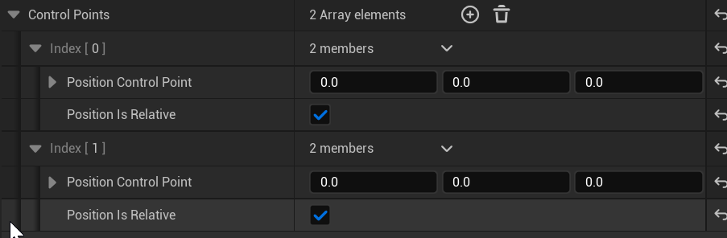
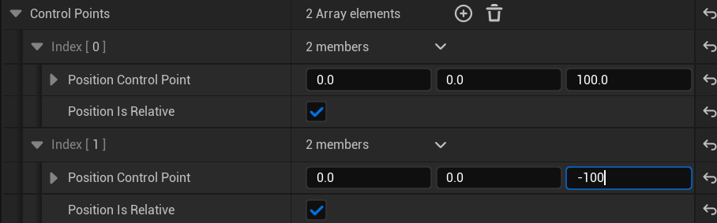
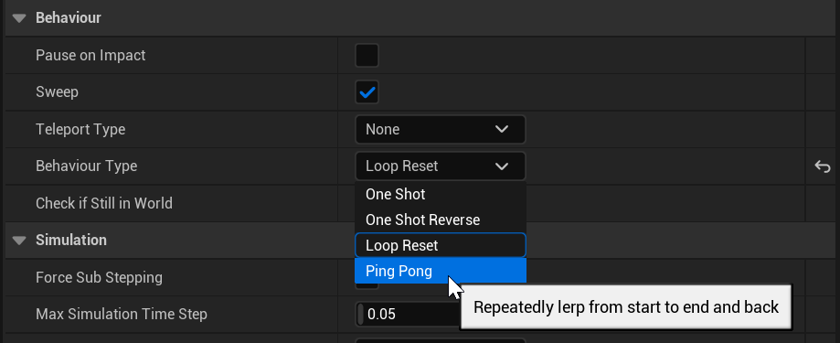

# Unreal: Movement: Interp To Movement (Move to Position)

> Legacy lesson, organized for self-study. Screenshots may show an older editor. See the Unreal 5.8 verification scope (legacy attachment omitted) before relying on version-specific steps.

The Interp To Movement Component moves an Actor to a position over some set duration, updating its position per tick. This allows for programming smooth movement across space.

## *What is the Interpt To Movement Component?*

When added to an Actor, the Interp To Movement component has two important values:

- Duration: How long should the movement take? (Default is 1 second.)
- Control Points: To what positions (relative to current or within the level) should the actor visit during its movement.

*Figure: Screenshot highlighting the Control section of the Interp To Movement component.*

## *How do I add control points?*

By default, the Interp To Movement component will have no control points. This means it will not move.

It needs to be told what positions to visit during its movement.

The "+" (Add Element) option allows us to define one or more positions for movement.

*Figure: Screenshot showing the "Add Element" option for Control Points.*

When an element is added, Control Points will show an "Index (0)" option. The number shown is the amount starting with 0.

Clicking on its drop-down arrow will show the entries for it, which include the position and if the movement should be relative or in level space.

*Figure: Screenshot showing the Position Control Point and Position Is Relative entries.*

For movement across space, there should be at least two Control Points. Click on the "Add Element" option again will generate a new position in the collection.

By default, the *Position Is Relative* option will be enabled. This is useful, as movement can be targeted to the relative position of the actor itself. This allows us to define how much we want to move in a direction and then move to another position or back again.

## Example: Moving Up and Down

With two positions defined, it is possible to move an Actor up and down based on its relative position. For this example, we will have the Actor move up 100 units and then back down a 100 units.

*Figure: Screenshot showing the movement on the z-axis for 100 units (up) and -100 units (down).*

Finally, with the positions defined, we will change the behavior of the movement.

*Figure: Screenshot showing the Behavior Type set to "Ping Pong" for moving back and forth.*
