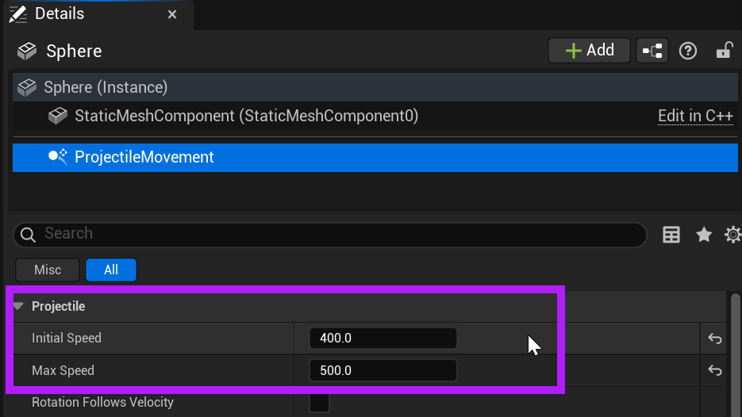
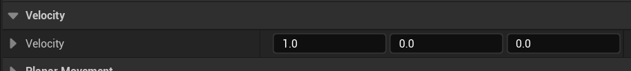
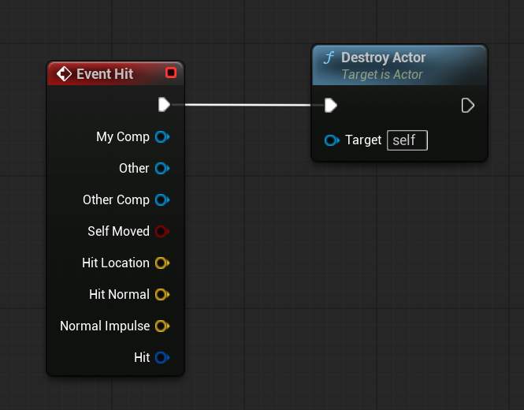

# Unreal: Movement: Projectile Movement (Movement across space in a direction)

> Legacy lesson, organized for self-study. Screenshots may show an older editor. See the Unreal 5.8 verification scope (legacy attachment omitted) before relying on version-specific steps.

The Projectile Movement Component moves an Actor in a set direction, updating its position every tick.

## *What is the Projectile Movement Component?*

When added to an Actor, there are two core values for defining movement.

- **Initial Speed**: How fast should the projectile initial move?
- **Max Speed**: How fast should the projectile move and then cap?

*Figure: Screenshot highlighting the Initial Speed and Max Speed.*

**A projectile will continue until it encounters an unmovable object or it is otherwise removed from the level**. This is important to remember, as we often need to keep track of projectiles or have them remove themselves from a level.

By default, a projectile will move along the x-axis. This is defined in the Velocity section.

*Figure: Screenshot showing the default velocity along the x-axis defined as 1.0.*

## Example: On Hit, Destroy Actor (Self)

While most of the time we are interested in the Overlap event, for static meshes, there will be no overlap event. Because the mesh is static, it will not change and is a solid shape.

Instead, we need the Hit event, which will be triggered as part of on anything touching the projectile in any way.

*Figure: Screenshot showing the sequence of Event Hit -\> Destroy Actor.*
