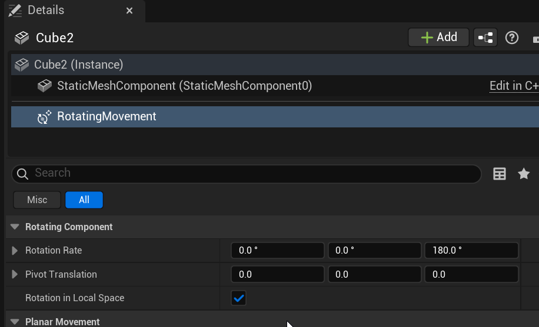
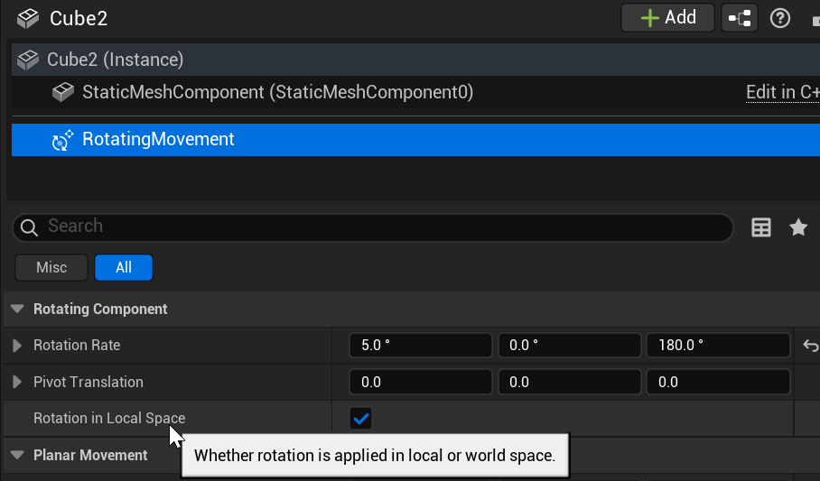

# Unreal: Movement: Rotating Movement Component (Rotate in space)

> Legacy lesson, organized for self-study. Screenshots may show an older editor. See the Unreal 5.8 verification scope (legacy attachment omitted) before relying on version-specific steps.

The Rotating Movement Component rotates an Actor in space, updating its position per tick. This allows for programming smooth rotation across space.

## *What is the Rotating Movement Component?*

When added to an Actor, the Rotating Movement Component allows for defining a rotate across the x, y, and/or z-axis.

*Figure: Screenshot showing the Rotation Rate for x, y, and z-axis.*

## Example: Rotating on x-axis in position

With the option of *Rotation in Local Space* enabled, we can have an Actor rotate in position.

Setting, for example, 5 degree rotation rate on the x-axis will cause the actor to rotate in space.

*Figure: Screenshot showing a Rotation Rate of 5 degrees with Rotation in Local Space enabled.*
