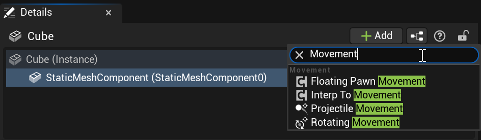

# Unreal: Movement: What is the Movement (Floating Pawn, Interp To, Projectile, and Rotation) Component?

> Legacy lesson, organized for self-study. Screenshots may show an older editor. See the Unreal 5.8 verification scope (legacy attachment omitted) before relying on version-specific steps.

In Unreal, we often have a need to have some actor move on its own. We may do this as a result of player input, but we may also want to have things in a level move on their own to, for example, move between two points or infinitely rotate. For these and other purposes, there is the [Movement Component](https://dev.epicgames.com/documentation/en-us/unreal-engine/movement-components-in-unreal-engine).

To help specify the type of movement, Unreal breaks the movement component into four components designed for a type of movement:

- **Character / Floating Pawn Movement**: If we want a character to move based on either player input or enemy programming, we use this. This is also known as Floating Pawn Movement.
- **Interp To Movement**: If we want an Actor to move towards a specific position over time, we use the Interpt To Movement Component.
- **Projectile Movement**: If we want an Actor to move continuously, we use the Projectile Component.
- **Rotation Movement**: If we want an Actor to rotate continuously, we use the Rotation Component.

These components options can be found by clicking on "Add" in the Details Tab and then searching for "Movement":

*Figure: Screenshot showing the four types of movement components.*
