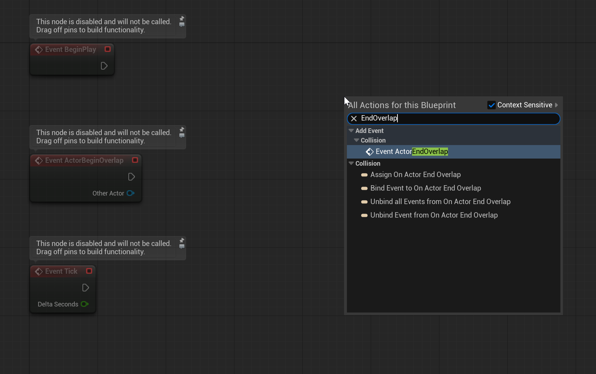
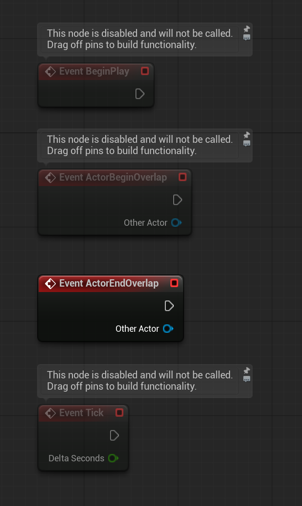

# Unreal: Volumes: Adding Overlap Events

> Legacy lesson, organized for self-study. Screenshots may show an older editor. See the Unreal 5.8 verification scope (legacy attachment omitted) before relying on version-specific steps.

By default, we are given access to the ActorBeginOverlap event. However, we might want access to other events. In fact, there are two core overlap events we can use:

- BeginOverlap
- EndOverlap

## *How do we add an Event Node to a Event Graph?*

When viewing the Event Graph, we can right-click and then search for the node we want.

*Figure: Screenshot of Event Graph showing a search for "EndOverlap" event node.*

When selected, the new node will be added to the Event Graph.

*Figure: Screenshot of BeginOverlap and EndOverlap event nodes in Event Graph.*

## *If we have "begin" and "end", how do we know if an actor started overlapping and has not stopped yet?*

While it may seem strange to only have two overlap events, begin and end, there is another event we can use to test if an overlap is still happening. The event node is named **Tick**.

In Unreal, the *Tick* event runs, by default, every frame. This provides an easy way to check things based on the drawing of frames to the screen.
