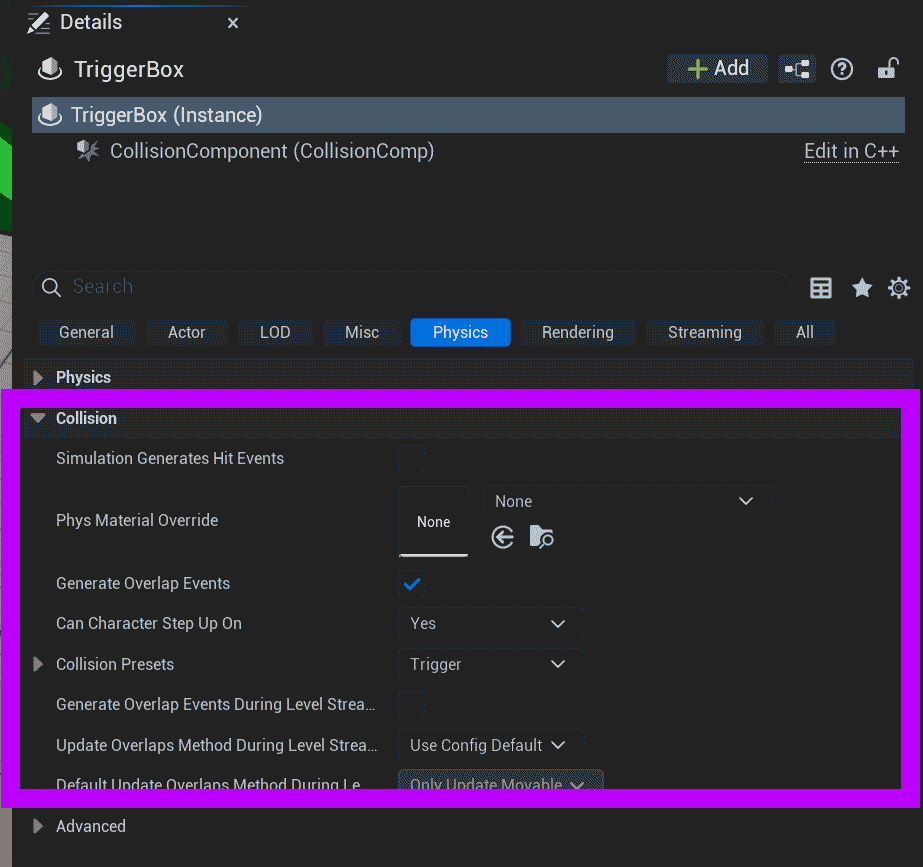
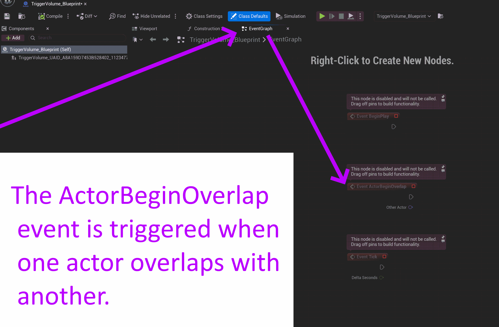

# Unreal: Volumes: What is a "trigger"?

> Legacy lesson, organized for self-study. Screenshots may show an older editor. See the Unreal 5.8 verification scope (legacy attachment omitted) before relying on version-specific steps.

In Unreal, a *trigger* is a preset collection of values defining the physics interactions between some actor (almost always a volume, but not exclusively) and other actors. When an overlap happens, it is "triggered."

**A *trigger* is a way to define a three-dimensional "button" for building other, more complex interactions.**

To help with faster development, Unreal defines a *Trigger Box* as an actor with the pre-defined Physics and Transform values.

*Figure: Screenshot of the default Collision values for a Trigger Box.*

## Example: Trigger Blueprint

Because a Trigger Box comes with pre-defined values, when we convert it into a Blueprint, we gain access to "overlap" events. By default, we can access the ActorBeginOverlap event.

*Figure: Screenshot of Trigger Volume Event Graph showing the ActorBeginOverlap Event.*
