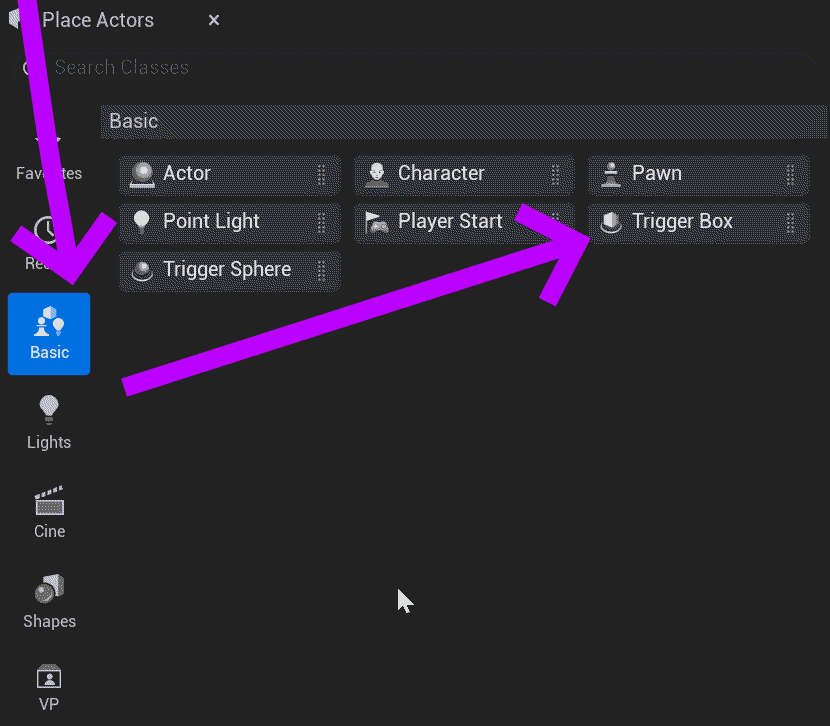
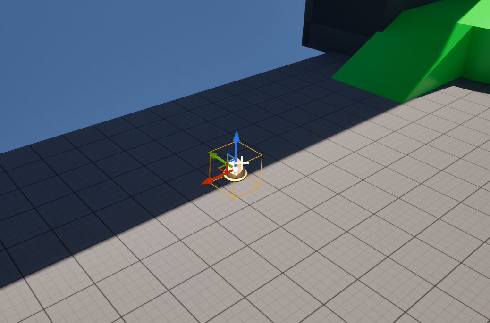

# Unreal: Volumes: What is a volume?

> Legacy lesson, organized for self-study. Screenshots may show an older editor. See the Unreal 5.8 verification scope (legacy attachment omitted) before relying on version-specific steps.

While we can use shapes and geometry to do many things, Unreal also defines a range of actors for the specific purpose of a character in the level moving through its space. Unreal calls these **volumes**.

**A volume is like a "subtractive" geometric actor, in that it does not appear during play, but is designed for specific, smaller actions.**

A common type of volume is a *Trigger Box*. This "triggers" when something passes through its space.

## Adding a Trigger Box

A Trigger Box can be found under the Basic category in the Place Actors tab.

*Figure: Screenshot showing the Basic -\> Trigger Box option in the Place Actors tab.*

When placed in a level, a Trigger Box will appear as an outline in the space with an arrow pointing to a "button" as its icon.

*Figure: Screenshot of Trigger Box in Unreal Editor.*
