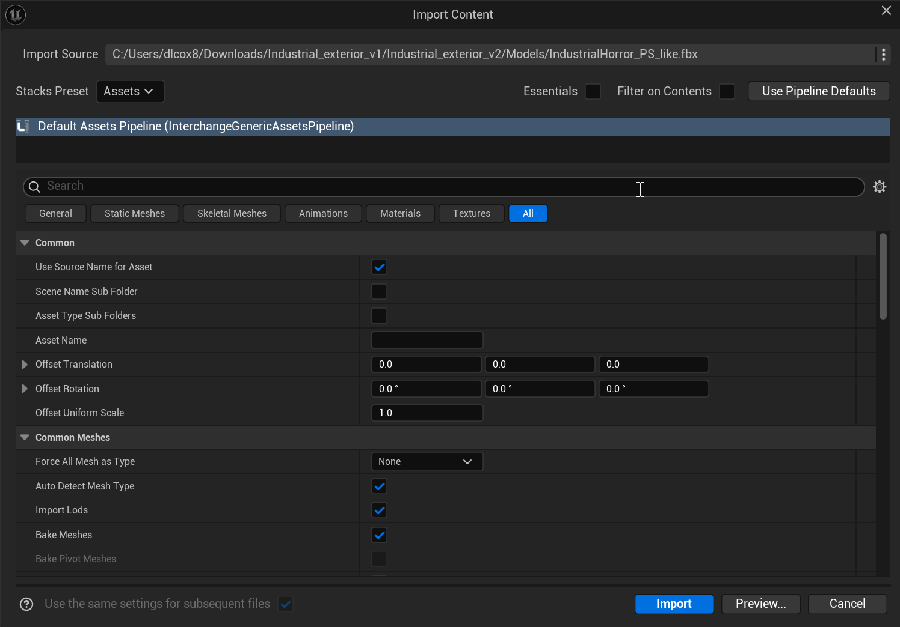
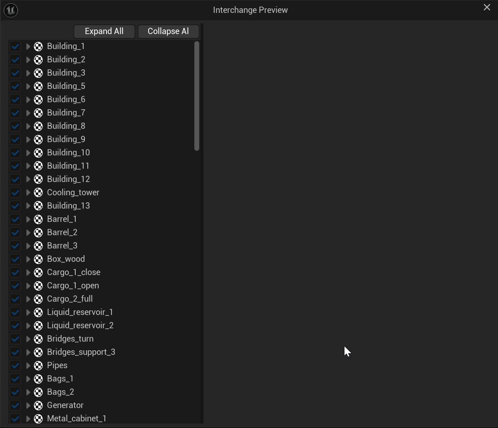
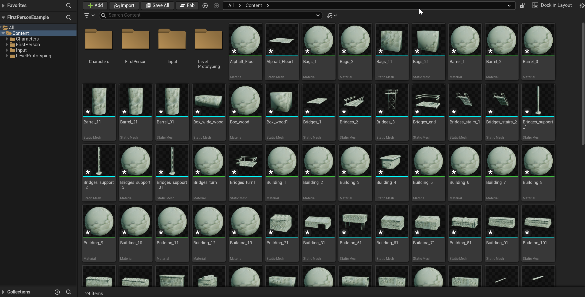

# Unreal: 3D Models: Importing files using Content Drawer

> Legacy lesson, organized for self-study. Screenshots may show an older editor. See the Unreal 5.8 verification scope (legacy attachment omitted) before relying on version-specific steps.

There are multiple ways to import content into Unreal. If we are dealing with files, we often want to use the Content Drawer -\> Import process.

## *How do we import models?*

If the model is one of the common formats (FBX, OBJ, glTF), we can use the Content Drawer.

Using the standard Content Drawer -\> Import process, we will be given a window if the imported file contains multiple models.

*Figure: Screenshot of import pipeline for multiple assets in a single file.*

Often, we want to know exactly what we are importing. For this, we can click on "Preview...", which will show you a listing of all models and their associated materials.

*Figure: Screenshot of listing of many different models as part of a single file.*

If, instead, we click on "Import", all of the models and textures will be added to our project. (Depending on the number of models, the textures included, and other details like their resolution, this process can take a long time.)

*Figure: Screenshot showing the import of many models and textures into a project.*

After the import pipeline is finished, there will be one or more added static meshes and materials added for use in the project.
