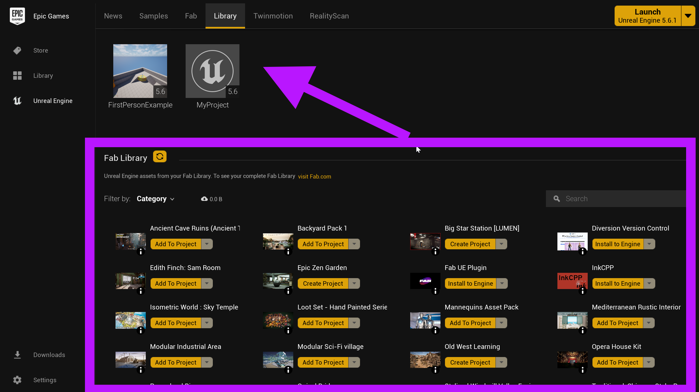
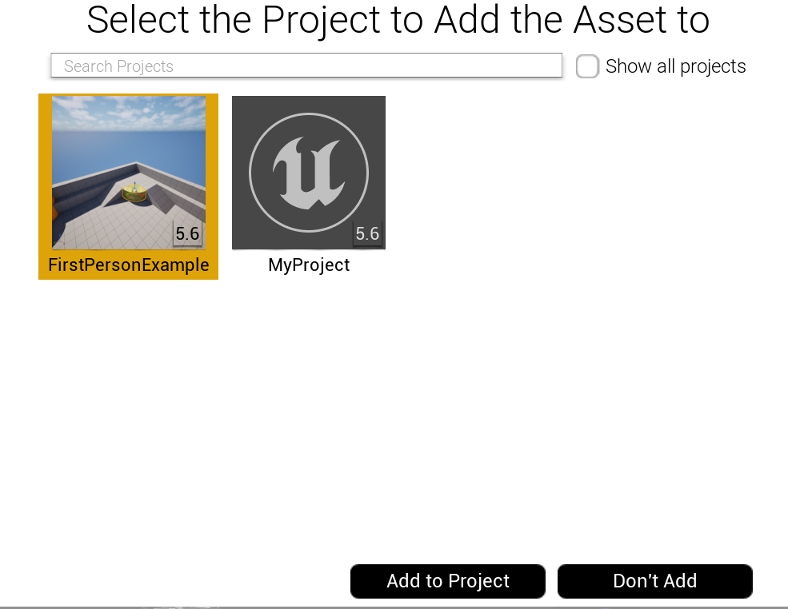
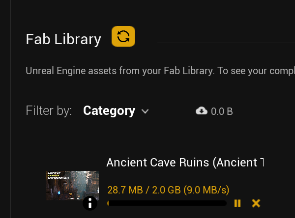
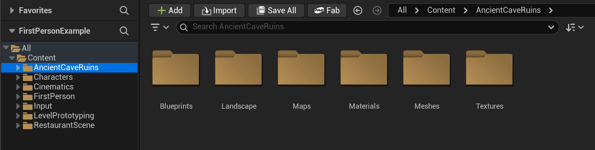

# Unreal: 3D Models: Importing from Fab.com (When a project is closed)

> Legacy lesson, organized for self-study. Screenshots may show an older editor. See the Unreal 5.8 verification scope (legacy attachment omitted) before relying on version-specific steps.

There are multiple ways to import from Fab.com, [the digital marketplace and asset store owned by Epic Games](https://www.fab.com/).

**NOTE**: While some content is free, others are paid. Be careful with what you select!

The easiest approach to importing anything purchases in Fab.com **is to close the Unreal Editor first**. Yes, this is the easiest way. Save the project and close it.

Then, open the Epic Games Launcher.

## Adding Fab.com Content from the Epic Games Launcher

In the Library section of the Epic Games Launcher, you will see any content added in Fab.com with an option of "Add to Project.

**Click on the "Add to Project" option for the content from Fab.com. This will prompt which project to select.**

*Figure: Screenshot showing the Epic Games Launcher and Fab Library.*

Next, Epic Games Launcher will ask for confirmation on which project to import to.

*Figure: Screenshot showing the "Select the Project to Add the Asset to" window after clicking on the "Add to Project" option.*

If the content was not previously downloaded to the computer, it will be downloaded by the Epic Games Launcher.

**In this example, the Ancient Cave Ruins pack was picked.**

*Figure: Screenshot showing the downloading of the Ancient Cave Ruins pack.*

Once added, the contents of the selection will be added to the project in a folder of the same name. (This can only be seen by opening the project in the Unreal Editor.)

*Figure: Screenshot showing the imported contents from Fab.com in a folder matching the name of the selection.*
