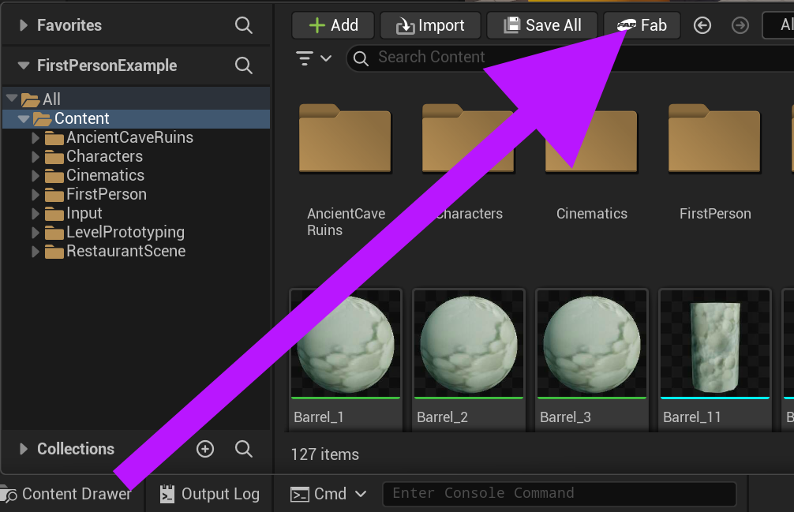
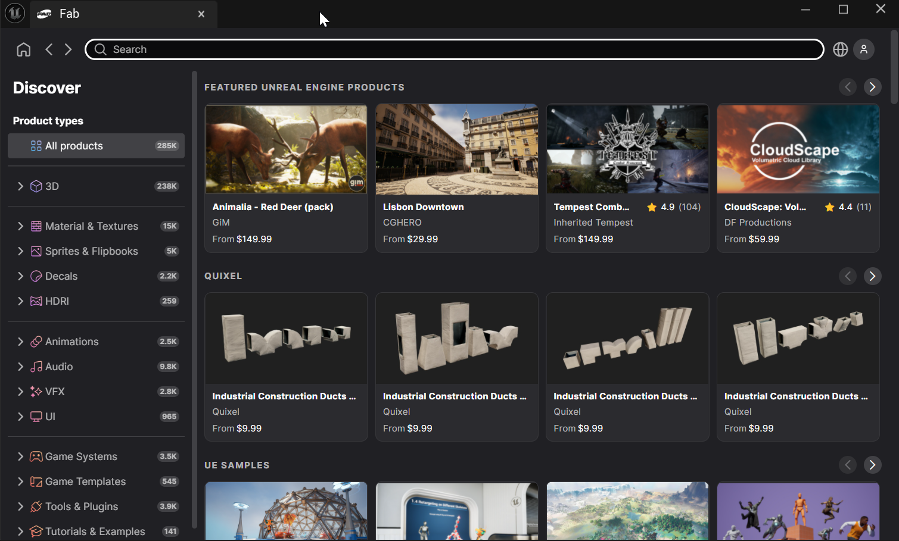
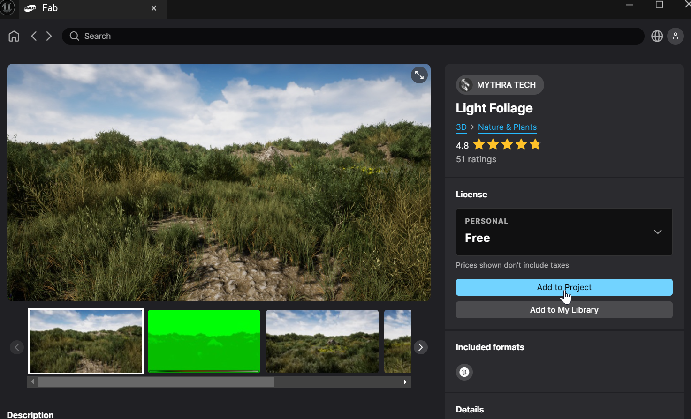
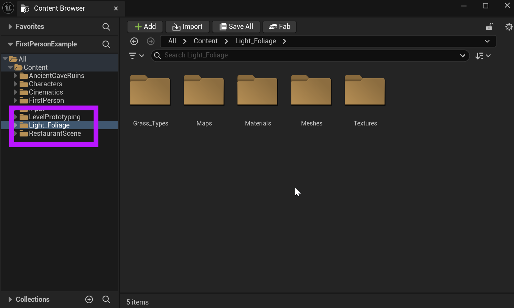

# Unreal: 3D Models: Importing from Fab.com (When a project is open)

> Legacy lesson, organized for self-study. Screenshots may show an older editor. See the Unreal 5.8 verification scope (legacy attachment omitted) before relying on version-specific steps.

There are multiple ways to import from Fab.com, [the digital marketplace and asset store owned by Epic Games](https://www.fab.com/)

[Links to an external site](https://www.fab.com/)**NOTE**: While some content is free, others are paid. Be careful with what you select!

The (sometimes) more difficult approach to importing from Fab.com is while a project is open is to use the "Fab" button as part of the Content Drawer. **In this approach, you must search for the content you want.** You will not have direct access to your library.

## Adding Fab.com Content from the Unreal Editor

When a project is open, the Content Drawer can be opened. Within the Content Drawer is a button labeled "Fab".

*Figure: Screenshot showing the Fab button in the Content Drawer.*

When using the "Fab" button, a new window will open.

*Figure: Screenshot showing the Fab window.*

Once the window is open, use the selections or search bar to find the content wanted.

Once found, click on the selection.

**NOTE: In this example, the "Light Foliage" item is selected.**

*Figure: Screenshot showing the "Add to Project" option in the Fab.com window.*

In the Fab window, click on the "Add to Project" option.

If the content is compatible with your project, it will be added in a folder of the same name.

For this example, the addition of the "Light Foliage" selection will download and create a folder.

*Figure: Screenshot highlighting the addition of the "Light Foliage" folder and content to the project.*
