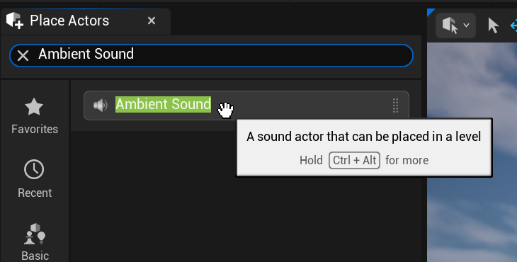
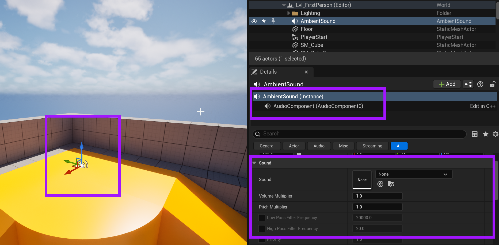

# Unreal: Audio: Adding Ambient Sound

> Legacy lesson, organized for self-study. Screenshots may show an older editor. See the Unreal 5.8 verification scope (legacy attachment omitted) before relying on version-specific steps.

While the Audio Component is very useful, we do not need to add it directly to Actors. Instead, as we have seen, we can spawn a sound as needed. We can also use a prepared actor named **Ambient Sound**. This will allow us to place a sound at some location and have it play a sound.

Within the Place Actors window, we can search for "Ambient Sound" to find it.

*Figure: Screenshot of the "Ambient Sound" actor found from a search in the Place Actors window.*

The Ambient Sound actor is useful for placing a sound in a location where it will play in a loop or as part of a long-running sound effect (such as water flowing).

*Figure: Screenshot highlighting the use of an Ambient Sound actor and its Audio Component.*
