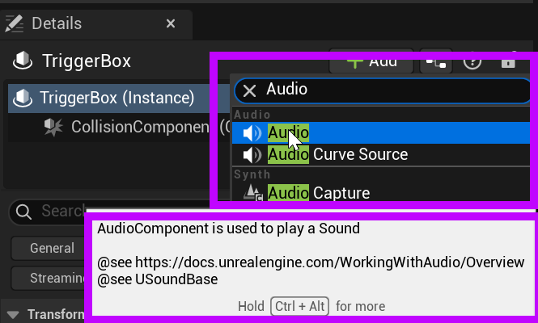
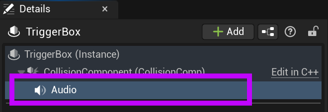
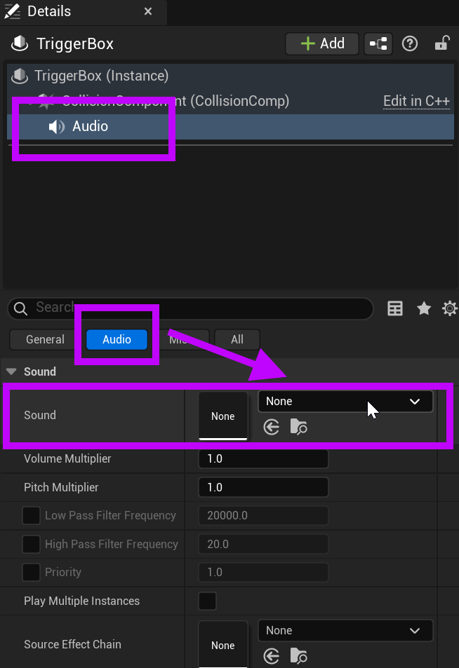
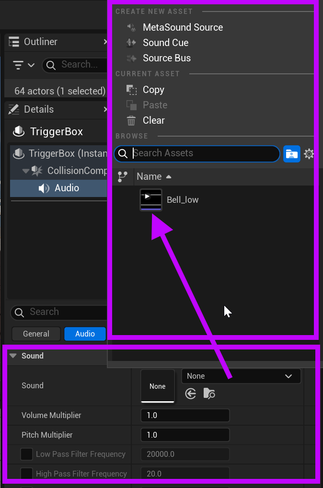
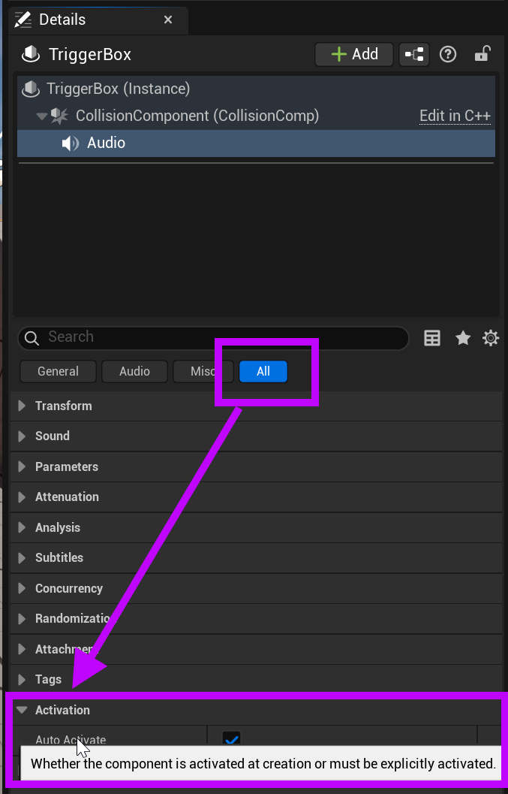

# Unreal: Audio: Audio Component (Play an audio file)

> Legacy lesson, organized for self-study. Screenshots may show an older editor. See the Unreal 5.8 verification scope (legacy attachment omitted) before relying on version-specific steps.

Once we have an imported audio file of a type supported by Unreal (WAV, MP3, OGG (Vorbis and Opus), FLAC, and AIFF), we can immediately use it as part of a common component available to all Actors: **audio component**.

## Adding Audio Component to an Actor

In the Details window, searching for "Audio" will reveal the **Audio Component**.

*Figure: Screenshot highlighting a search for the "Audio" component.*

Adding the Audio Component to an actor will make it a sub-component of the existing components. (This may seem odd for those coming from another game engine such as Unity, where this is not possible, but is desired in Unreal! We often want to do this!)

*Figure: Screenshot highlighting the added "Audio" component to an existing Actor.*

## Adding a File to Audio Component

Once the Audio component has been added to an Actor, its values will be available to be edited under the Details window.

An added Audio Component will add an "Audio" section in Details for the selected Actor.

*Figure: Screenshot highlighting the Audio Component with Sound value.*

If we have at least one audio file of a supported file type (WAV, MP3, OGG (Vorbis and Opus), FLAC, and AIFF), it will appear in the drop-down menu.

*Figure: Screenshot highlighting the Sound value and possible entries from the drop-down menu.*

## Auto-playing an associated files (Auto Activate disabled)

By default, if an audio file is connected to an Audio Component, it will be auto-played.

A common, and useful way, to stop this, is to disable the Auto Activate of the Audio Component itself. (There are other ways to do this.)

*Figure: Screenshot highlighting "Activation" section and Auto Activate value.*
