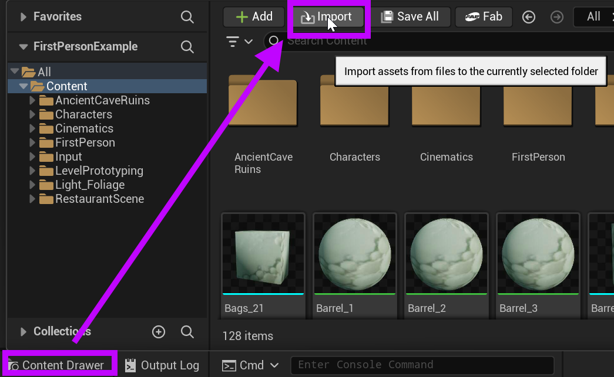
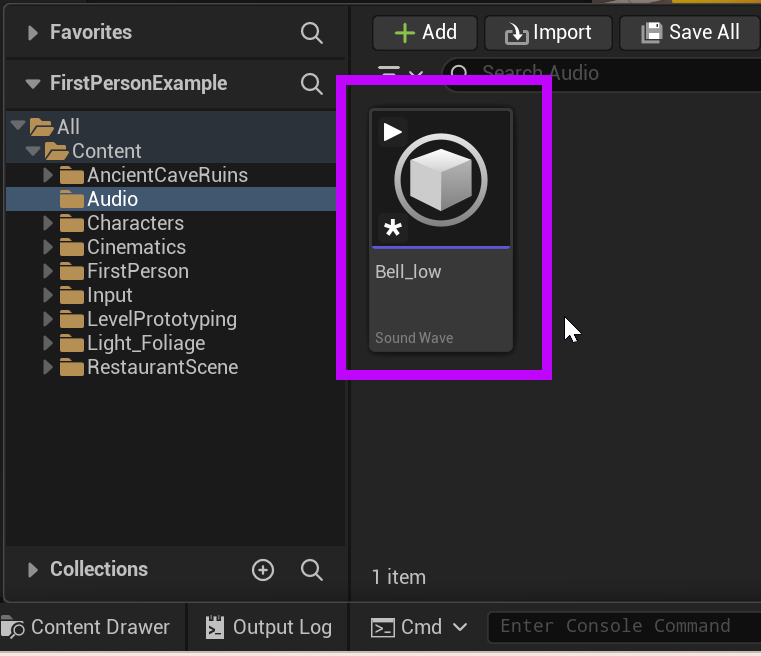

# Unreal: Audio: Importing Files

> Legacy lesson, organized for self-study. Screenshots may show an older editor. See the Unreal 5.8 verification scope (legacy attachment omitted) before relying on version-specific steps.

Importing files follows a pattern we have already seen. We use the Content Drawer -\> Import process and select the files we want.

*Figure: Screenshot highlighting the use of Content Drawer -\> Import process for adding files to a project.*

When a compatible audio file (WAV, MP3, OGG (Vorbis and Opus), FLAC, and AIFF) is imported into Unreal, it will identified as a "Sound Wave" asset in the Content Drawer.

*Figure: Screenshot highlighting an imported audio file as a Sound Wave in the Content Drawer.*
