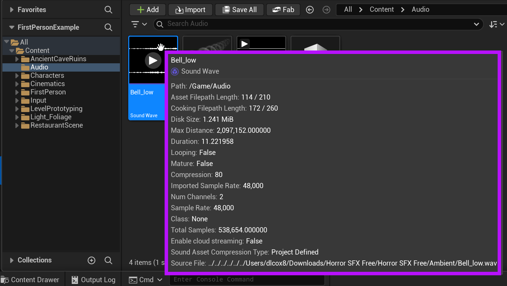
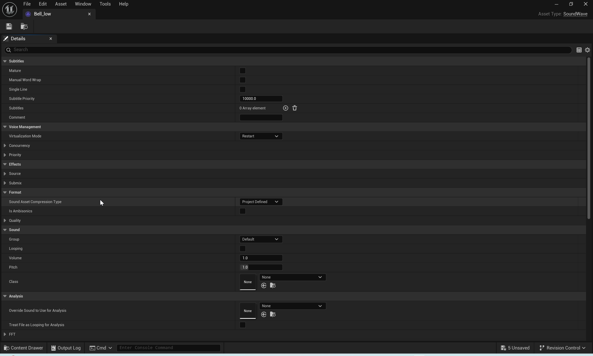
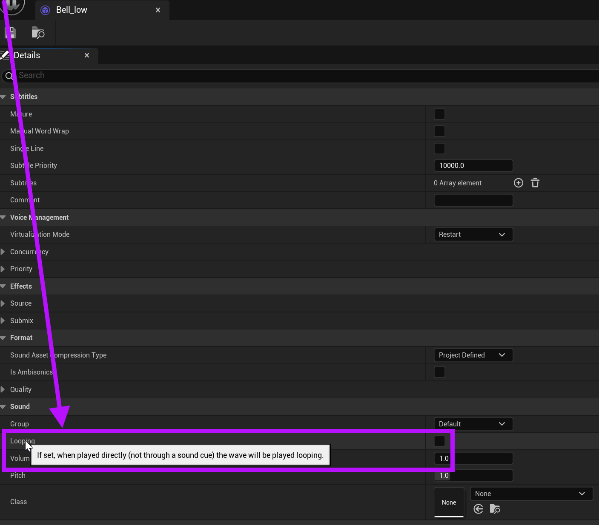

# Unreal: Audio: Looping Audio (Per File Setting)

> Legacy lesson, organized for self-study. Screenshots may show an older editor. See the Unreal 5.8 verification scope (legacy attachment omitted) before relying on version-specific steps.

At first, it may seem confusing when trying to figure out some audio settings, like *looping*, in Unreal. However, the place for many things related to an audio are in the file itself. Each file has many different settings in Unreal placed in a separate window for the file itself.

When viewing the Content Drawer, hovering the cursor over a Sound Wave will show its current settings.

*Figure: Screenshot highlighting settings of an audio file on the Content Drawer.*

To edit many of these settings, double-click on the file itself. This will open a new window with options and additional values to adjust for the file.

*Figure: Screenshot showing all of the options for a Sound Save asset named Bell_low.*

## Enabling Looping

The option to look the audio (on a per file basis) is found under the Sound category after double-clicking on a Sound Wave file in the Content Drawer.

*Figure: Screenshot highlighting the Looping setting in the Sound category of the Details for a Sound Wave asset.*
