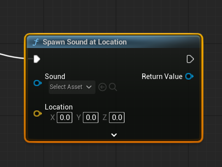
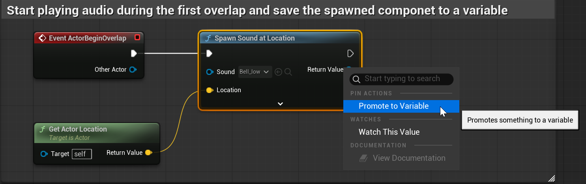
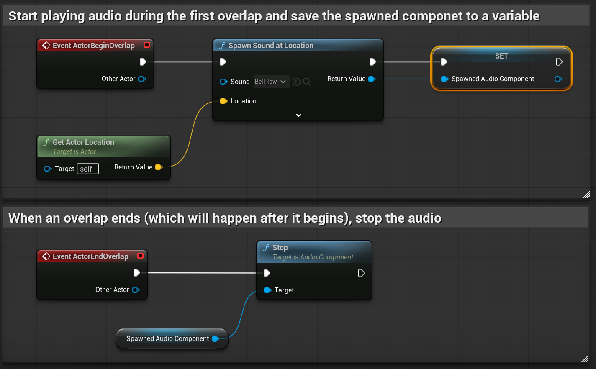

# Unreal: Audio: Spawn Sound at Location

> Legacy lesson, organized for self-study. Screenshots may show an older editor. See the Unreal 5.8 verification scope (legacy attachment omitted) before relying on version-specific steps.

We often want to play a sound as part of some other events. For example, we may want to play a sound when a player-character collects an item. We may want to play a sound when an enemy character passes through a gate. For all of these, and many other events, we can use a useful node for spawning a sound at a location. This node is named [Spawn Sound at Location](https://dev.epicgames.com/documentation/en-us/unreal-engine/BlueprintAPI/Audio/SpawnSoundatLocation).

*Figure: Screenshot showing the Spawn Sound at Location node.*

If the project has any Sound Wave assets, these can be selected from the Sound input pin.

The location of where to spawn the sound can also be set using the Location input pin.

## Example: Play Sound During Overlap, Stop When Overlap Ends

First, pull off the ActorBeginOverlap event to use the Spawn Sound at Location node. Select the sound to play. Next, create a Get Actor Location node and connect it with the Spawn Sound at Location node to set the location to be the same as the overlapping node.

Third, as part of the same sequence, promote the output pin of the Spawn Sound at Location to a variable of the Blueprint. (This will save what is spawned so we can access it later.)

*Figure: Screenshot of sequence of nodes from Actor Begin Overlap to Spawn Sound at Location and the promotion of a variable from the output pin.*

To stop the playing of the sound during the overlap event end, we will use the variable created.

Getting the value of the variable will allow access to its functions like Play and Stop.

Get the saved variable's value and its Stop node.

Through using the event Actor End Overlap, connect it to the Stop node.

*Figure: Screenshot of example node sequences of playing audio on overlap, stop on end.*
