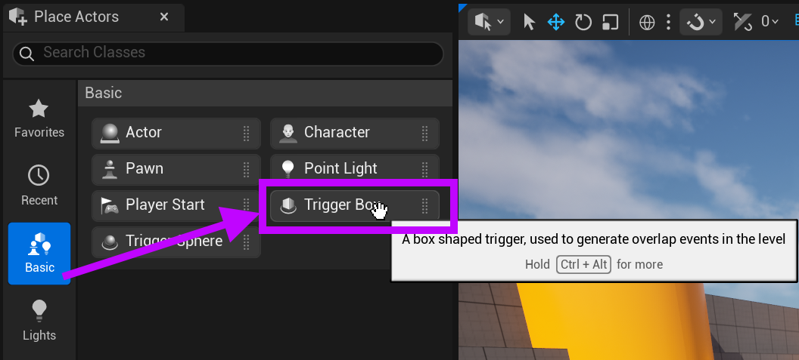
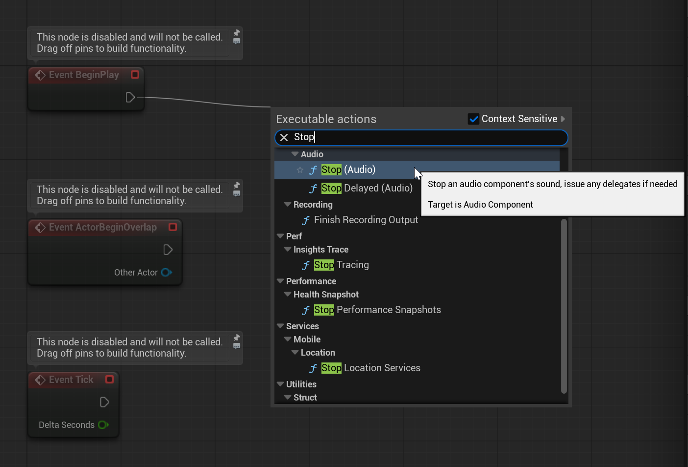
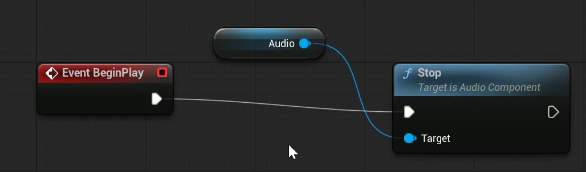
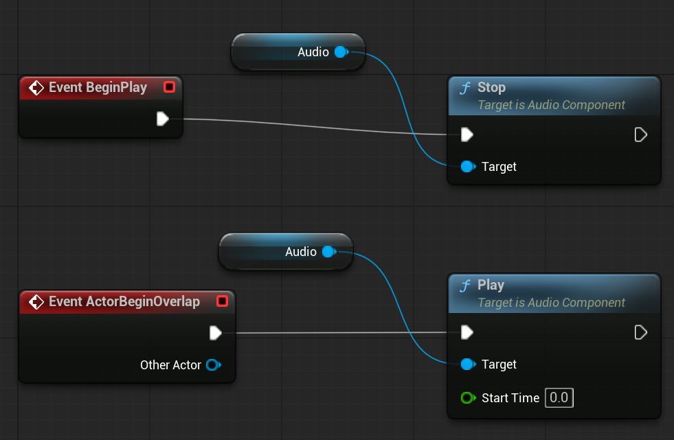
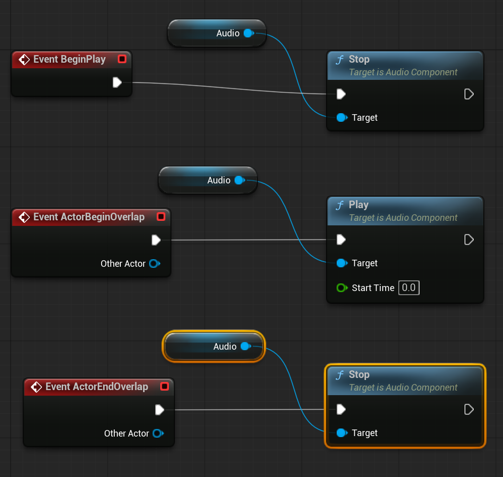

# Unreal: Audio: Trigger Box + Audio Component (For sound effects)

> Legacy lesson, organized for self-study. Screenshots may show an older editor. See the Unreal 5.8 verification scope (legacy attachment omitted) before relying on version-specific steps.

We have already seen how useful a Trigger Box is in Unreal. (This is why it is grouped in the Basic category.)

*Figure: Screenshot highlighting the Basic -\> Trigger Box workflow of easily finding the prepared Actor.*

## Using Trigger Box + Audio Component

One of the more useful approaches to using the Audio Component is with a Trigger Box. This allows us to "trigger" a sound when an Actor passes through its volume.

To use this approach, we first add an Audio Component to a Trigger Box.

Once added, we can then associate a file.

Next, convert the Trigger Box + Audio Component combination to Blueprint. (It is recommended to name this something like "Sound Trigger" to identify the combination.)

**Note**: Do not disable the component with the Auto Activate value disabled. We will, in the next part, review a different approach.

## Using Events to Stop and Play Audio

When the Audio Component is added, we gain access to more nodes as part of the component.

We are interested in three events.

First, during BeginPlay, we will stop the audio from automatically playing.

Next, as part of ActorBeginOverlap, we will play the audio.

Finally, as part of ActorEndOverlap, we will end the audio playing.

### When BeginPlay, Stop Audio

Pulling off the BeginPlay event, search for "Stop" and select the "Stop (Audio)" node.

(By default, the audio will play. We want to stop this action when play begins.)

*Figure: Screenshot showing a search for the "Stop (Audio)" node from the context menu.*

When the "Stop (Audio") node is added, it will automatically grab the Audio value from the component. (Assuming it was set in the Unreal Editor!)

*Figure: Screenshot of use of Stop node drawing from Audio component.*

## When ActorBeginOverlap, Play Audio

A Trigger Box provides overlap events.

From the ActorBeginOverlap event, pull off the Play (Audio) node.

*Figure: Screenshot showing the Stop and Play audio nodes connected to the BeginPlay and ActorBeginOverlap events.*

## When ActorEndOverlap, Stop Audio

Finally, let's tell the audio to stop when the ActorEndOverlap event happens.

For this, we will right-click and search for "ActorEndOverlap".

*Figure: Screenshot showing the BeginPlay, ActorBeginOverlap, and ActorEndOverlap events and Stop and Play nodes.*
