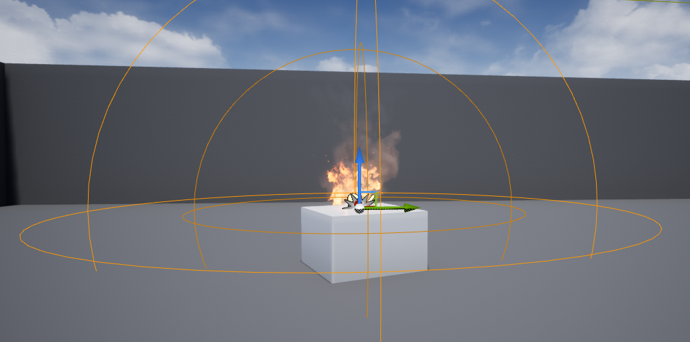
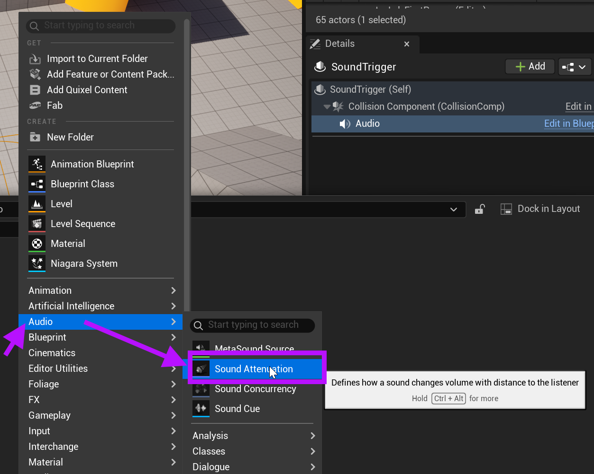
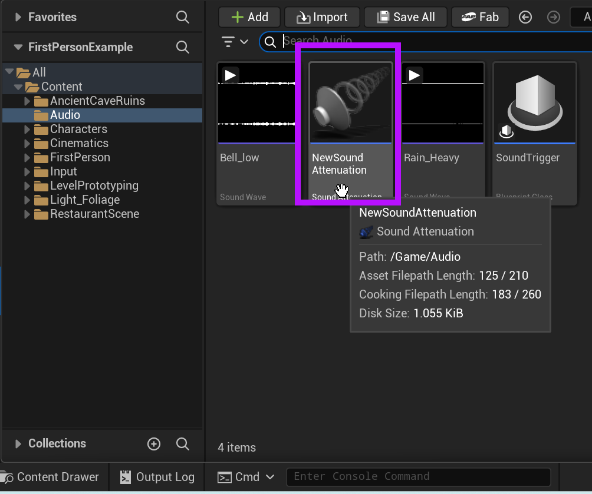
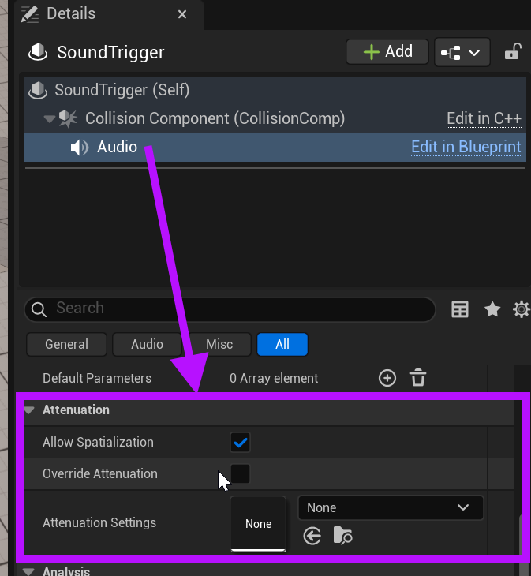
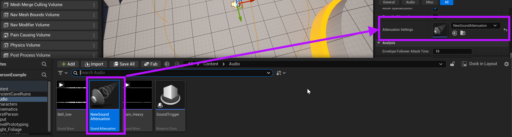

# Unreal: Audio: What is Sound Attenuation?

> Legacy lesson, organized for self-study. Screenshots may show an older editor. See the Unreal 5.8 verification scope (legacy attachment omitted) before relying on version-specific steps.

In Unreal, Sound Attenuation is a set of values describing the propagation of sound values in a three-dimensional space. We can create a set of values for how loud a Sound Wave is when we are close, in a medium range, and outside it range. Put simply: the distance of us to the source will affect how loud the sound is.

Sound Attenuation allows us to define something where, when the player-character moves away from the source, the volume will be less until either the sound ends of the player-character moves far enough away.

*Figure: Screenshot showing the attenuation ranges of a sound with its closer, medium, and far range.*

To use Sound Attenuation in Unreal, we must create an asset in the Content Drawer and then apply it to Audio components (or other, related components) as needed.

## Creating a Sound Attenuation Asset

In the Content Drawer, right-click.

From the menu, select Audio and then Sound Attenuation.

*Figure: Screenshot highlighting the Sound Attenuation asset type from the right-click menu in the Content Drawer.*

Once created, the Sound Attenuation asset will be shown in the current folder in the Content Drawer.

*Figure: Screenshot highlighting the creation of a Sound Attenuation asset in the Content Drawer.*

## Applying Sound Attenuation Asset

Once created, a Sound Attenuation asset can be applied to the Audio Component (and other with the same option).

To apply it to an Audio Component, drag and drop the asset into the Attenuation section of compatible components.

*Figure: Screenshot highlighting the Attenuation section of the Audio Component.*

When a Sound Attenuation asset is applied to the Attenuation Settings, the asset will be connected to the component.

*Figure: Screenshot highlighting the application of a Sound Attenuation asset to an example Audio Component.*
