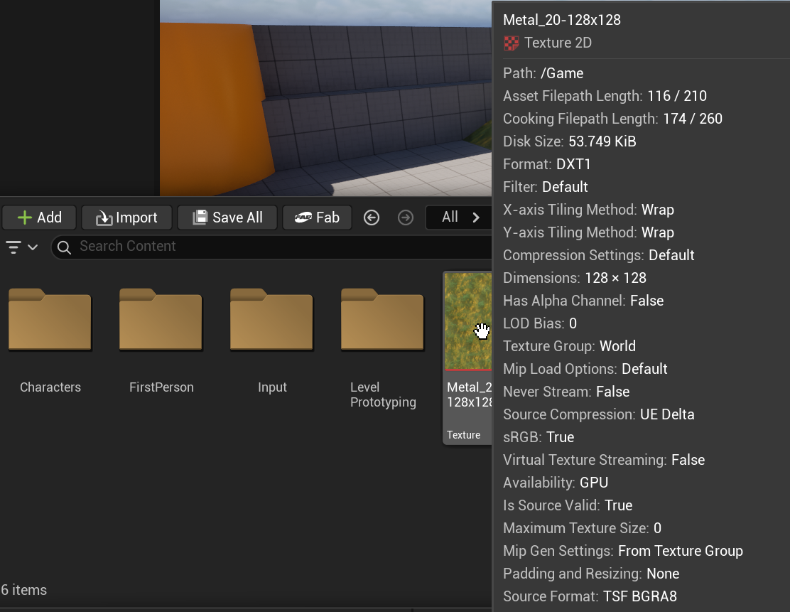

# Unreal: Materials: An imported image becomes a texture

> Legacy lesson, organized for self-study. Screenshots may show an older editor. See the Unreal 5.8 verification scope (legacy attachment omitted) before relying on version-specific steps.

When we import an image into Unreal, it becomes a **texture**.

**[A texture is image asset primarily, but not exclusively, used with materials.](https://dev.epicgames.com/documentation/en-us/unreal-engine/textures-in-unreal-engine) (We will later use images with user interface widgets as well.)**

When we import an image into Unreal (using the Content Browser -\> Import), the image is automatically a texture.

*Figure: Screenshot showing an imported image as a texture in Unreal.*

While useful for many purposes, textures can also be converted into something more useful for three-dimensional shapes like meshes. We can convert a texture into materials we can use with meshes and those we can use with volumes.
