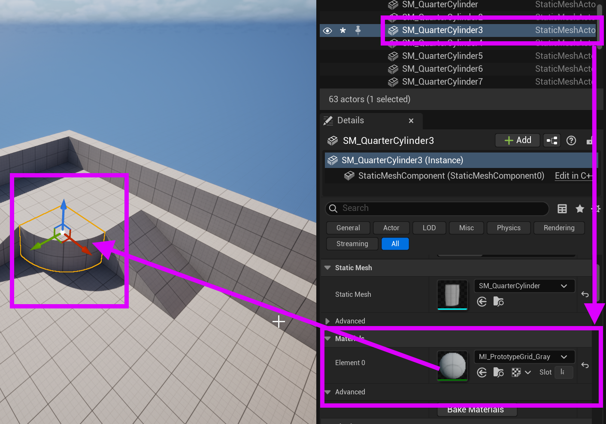
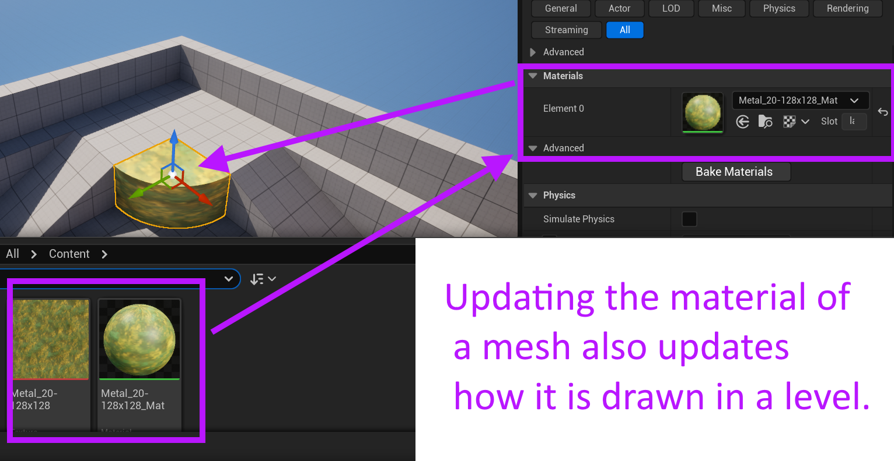

# Unreal: Materials: Applying Materials to Meshes

> Legacy lesson, organized for self-study. Screenshots may show an older editor. See the Unreal 5.8 verification scope (legacy attachment omitted) before relying on version-specific steps.

When we add one of the shapes in the Place Actors window in Unreal, we are adding a static mesh, something whose shape will not change.

Static meshes can use materials to have Unreal "paint" some image over the shape. In fact, we have already seen many examples of this. By default, a grid-like pattern is painted over many static meshes in the templates like third-person and first-person.

*Figure: Screenshot showcasing the use of the grid material on the cylinder as part of the first-person template.*

If we have another material in the Content Drawer, we can open the drawer and then click-and-drag the new material on any static mesh to replace what is drawn over it.

*Figure: Screenshot highlighting the material of a mesh.*
